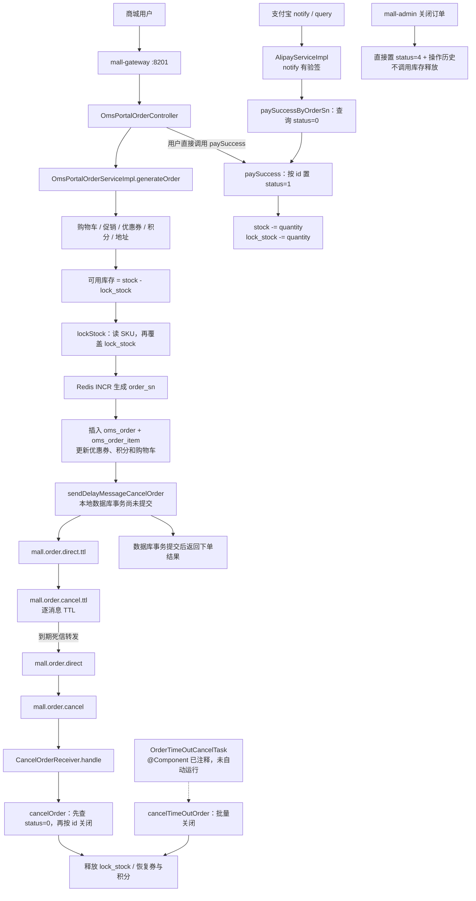
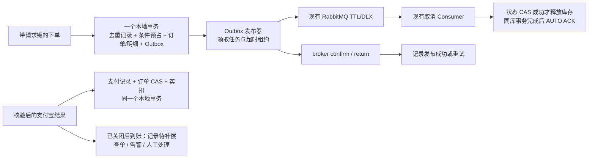

# mall-swarm 基线审计：Distributed Transaction & Payment Platform

审计日期：2026-11-16（Asia/Shanghai）  
仓库：[yyiixxin-maker/mall-swarm](https://github.com/yyiixxin-maker/mall-swarm)  
固定提交：[04c442fe318356bae4445a109dde7af297ce1e84](https://github.com/yyiixxin-maker/mall-swarm/commit/04c442fe318356bae4445a109dde7af297ce1e84)，master；提交时间 2026-05-21，提交说明“升级支持Spring Cloud 2025+Spring Boot 3.5”。

## 1. 结论、范围和证据边界

这是一套微服务商城。订单创建、订单支付落库、SKU 库存预占/实扣、优惠券和积分操作主要集中在 **mall-portal 同一个进程、同一个 mall 数据库**；mall-admin 还会独立修改同一批订单和 SKU 表。当前订单路径没有调用独立的支付或库存微服务。

**审计结论：技术版本声明已符合目标主线，可以沿用；交易正确性尚不能作为支付平台的可靠基线。** 第一优先级是修复支付可信边界、库存原子操作、支付/取消并发、数据库与 RabbitMQ 双写，再补持久化幂等和支付记录。

重要范围说明：

- 当前聊天工作区是 `%USERPROFILE%\Documents\Codex\2026-11-16\new-chat`，只有工作/输出目录；在 Codex 工作区根目录的检索中未发现 mall-swarm 本地 checkout。上一轮打开的是 GitHub 页面，尚未克隆。
- 本报告审计的是上述 GitHub 仓库的**固定提交快照**，不能代表另一份本地副本、未提交改动或实际线上配置。
- 已枚举完整 Git 树：967 个条目、782 个文件；读取并静态扫描 406 个相关文本文件，包括全部 303 个非 mall-mbg 的 Java 文件、10 个 POM、全部仓库内 YAML/属性/SQL 文件、相关自定义 XML 和生成 Mapper。对订单、库存、支付、消息主路径做逐段阅读；其余业务代码以检索为主。
- 数据库版本、Redis/RabbitMQ/Nacos 部署版本均区分“仓库声明”和“实际运行”。没有连接任何数据库、Redis、RabbitMQ、Nacos 或 Kubernetes 集群。
- 本轮未克隆、未运行 Maven、未启动服务、未执行 SQL、未修改源码/配置/依赖。唯一新增交付物是仓库外的本报告。
- 负载假设：多个用户并发下单、回调和 MQ 至少一次交付、portal 可有多个副本。下文并发风险来自源码推演，尚未经过运行时复现。
- 第 11–13 节均为**后续建议与预计文件**，未实施；所有拟新增类、表、内部接口都会明确标记为“拟新增”。

## 2. POM 与技术基线

### 2.1 指定的三个 POM

| 文件 | 已确认内容 | 证据 |
| --- | --- | --- |
| 根 pom.xml | 9 个子模块；父 POM Spring Boot 3.5.14；Java 17；Cloud 2025.0.2；Alibaba 2025.0.0.0 | [pom.xml:12–59](https://github.com/yyiixxin-maker/mall-swarm/blob/04c442fe318356bae4445a109dde7af297ce1e84/pom.xml#L12-L59) |
| mall-portal/pom.xml | mall-mbg、MongoDB、Redis、AMQP、Nacos discovery/config、OpenFeign、支付宝 SDK、Sa-Token、监控客户端；没有 Kafka 或 Seata starter | [pom.xml:20–80](https://github.com/yyiixxin-maker/mall-swarm/blob/04c442fe318356bae4445a109dde7af297ce1e84/mall-portal/pom.xml#L20-L80) |
| mall-common/pom.xml | Web、Redis、PageHelper、Spring Data Commons、Knife4j/Springdoc、日志、校验和 LoadBalancer；没有订单幂等/Outbox 框架 | [pom.xml:20–61](https://github.com/yyiixxin-maker/mall-swarm/blob/04c442fe318356bae4445a109dde7af297ce1e84/mall-common/pom.xml#L20-L61) |

根 POM 同时声明 `java.version=17`、`spring-boot.version=3.5.14`、`spring-cloud.version=2025.0.2`。Cloud 已固定为 **2025.0.2**，不是任意 2025.x；后续延续该已声明组合，不泛化为别的 release train。

| 相关依赖 | POM 声明版本 | 说明 |
| --- | --- | --- |
| MyBatis | 3.5.19；Starter 3.0.4 | 生成 Mapper 与自定义 DAO 共用 |
| MySQL Connector/J | 9.3.0 | 驱动版本，不是数据库版本 |
| Druid | 1.2.24 | Boot 3 starter |
| 支付宝 SDK | 4.40.630.ALL | 已存在，优先复用 |
| Sa-Token | 1.42.0 | 当前鉴权主线 |
| RabbitMQ 客户端/Spring AMQP | 由 Boot 依赖管理提供 | 未运行 effective-pom 或 dependency:tree，不能声称已验证最终解析版本 |

所有这些都是源码中现有的声明，没有从 FinFlow 复制依赖，也没有执行升级。

### 2.2 构建行为

- 根 POM 第 34 行 `skipTests=true`：默认跳过测试执行，不能把普通打包成功视为测试通过。不是 `maven.test.skip`，两者含义不同。
- 根项目继承 starter-test 和 AOP；portal 的 MyBatis 配置启用事务管理，接口已标记 `@Transactional`，见第 4 节。
- 根 POM 的 Docker 插件把镜像构建绑定在 package 阶段，配置远程 Docker `http://192.168.3.101:2375`，基础镜像 `openjdk:17`；portal/admin 等模块启用了该插件。因此复现测试时优先使用 test 生命周期，先核对插件配置，再执行 package。
- 本轮只确认声明，没有验证本机 JDK、Maven、远程 Docker 或依赖下载能否工作。

证据：[版本与跳过测试](https://github.com/yyiixxin-maker/mall-swarm/blob/04c442fe318356bae4445a109dde7af297ce1e84/pom.xml#L31-L59)、[Docker 插件配置](https://github.com/yyiixxin-maker/mall-swarm/blob/04c442fe318356bae4445a109dde7af297ce1e84/pom.xml#L275-L320)。

## 3. 当前模块清单

以下端口来自各模块 application.yml；依赖关系来自 POM/Feign 源码。

| 模块 | 类型/端口 | 当前职责与关键关系 |
| --- | --- | --- |
| mall-common | 公共库 | 通用响应、异常、RedisService、Redis 序列化与缓存、日志等 |
| mall-mbg | 公共库 | 生成的 Model/Example/Mapper/XML；依赖 mall-common，带入 MyBatis、Druid、JDBC |
| mall-portal | 服务 / 8085 | 会员、购物车、优惠计算、订单、SKU 库存更新、支付宝；依赖 mall-mbg，直接写 mall 库；唯一业务 RabbitMQ 生产/消费路径在此 |
| mall-admin | 服务 / 8080 | 商品、SKU、订单后台管理；依赖 mall-mbg，直接写同一批表 |
| mall-auth | 服务 / 8401 | AuthController 根据 clientId，通过 Feign 调 admin 的 /admin/login 或 portal 的 /sso/login |
| mall-gateway | 服务 / 8201 | WebFlux Gateway、Nacos 路由发现、Sa-Token 登录/权限检查、API 文档聚合 |
| mall-search | 服务 / 8081 | 商品搜索，MyBatis 查询并操作 Elasticsearch |
| mall-demo | 服务 / 8082 | Feign 调用演示 |
| mall-monitor | 服务 / 8101 | Spring Boot Admin 服务监控 |

`config/`、`document/docker/`、`document/k8s/`、`document/sql/` 是配置/部署/建库资料，不是 Maven 服务模块。

README 的组织结构仍称 mall-auth 为 OAuth2 认证中心，但当前 AuthController 是登录调用门面，鉴权链使用 Sa-Token；本报告以代码为准。README 技术列表中的 Seata 也不能作为已实现的证据。参见 [README.md:53–95](https://github.com/yyiixxin-maker/mall-swarm/blob/04c442fe318356bae4445a109dde7af297ce1e84/README.md#L53-L95) 与 [AuthController.java:23–49](https://github.com/yyiixxin-maker/mall-swarm/blob/04c442fe318356bae4445a109dde7af297ce1e84/mall-auth/src/main/java/com/macro/mall/auth/controller/AuthController.java#L23-L49)。

## 4. 订单、状态、库存的 Controller → Service → Mapper → SQL

### 4.1 当前入口与调用清单

HTTP 路径表同时列出网关外部前缀；控制器内部没有 /mall-portal 或 /mall-admin 前缀。

| 能力 / 外部路径 | Controller → Service | Mapper/DAO → SQL/表 |
| --- | --- | --- |
| POST /mall-portal/order/generateConfirmOrder | OmsPortalOrderController.generateConfirmOrder → OmsPortalOrderServiceImpl.generateConfirmOrder | OmsCartItemServiceImpl.listPromotion → OmsPromotionServiceImpl.calcCartPromotion → PortalProductDao.getPromotionProductList；读取购物车、商品/SKU、优惠券、积分规则 |
| POST /mall-portal/order/generateOrder | OmsPortalOrderController.generateOrder → OmsPortalOrderServiceImpl.generateOrder | PmsSkuStockMapper.selectByPrimaryKey/updateByPrimaryKeySelective 预占；OmsOrderMapper.insert；PortalOrderItemDao.insertList；更新券/积分/购物车 |
| POST /mall-portal/order/paySuccess | OmsPortalOrderController.paySuccess → OmsPortalOrderServiceImpl.paySuccess | OmsOrderMapper.updateByPrimaryKeySelective → oms_order；PortalOrderDao.updateSkuStock → pms_sku_stock |
| POST /mall-portal/alipay/notify | AlipayController.notify → AlipayServiceImpl.notify → OmsPortalOrderServiceImpl.paySuccessByOrderSn → paySuccess | 先按 order_sn/status=0 查询，再复用上述支付落库/实扣 SQL |
| GET /mall-portal/alipay/query | AlipayController.query → AlipayServiceImpl.query | 查支付宝成功时也调用 paySuccessByOrderSn，具有写订单/库存的副作用 |
| POST /mall-portal/order/cancelUserOrder | OmsPortalOrderController.cancelUserOrder → OmsPortalOrderServiceImpl.cancelOrder | OmsOrderMapper 先查未支付订单，再按主键置 status=4；OmsOrderItemMapper.selectByExample；PortalOrderDao.releaseSkuStockLock；返还券/积分 |
| POST /mall-portal/order/cancelOrder | OmsPortalOrderController.cancelOrder → sendDelayMessageCancelOrder | 这里只发送延迟取消消息，并非立即关闭 |
| POST /mall-portal/order/cancelTimeOutOrder | OmsPortalOrderController.cancelTimeOutOrder → cancelTimeOutOrder | PortalOrderDao.getTimeOutOrders/updateOrderStatus/releaseSkuStockLock |
| POST /mall-portal/order/confirmReceiveOrder | OmsPortalOrderController.confirmReceiveOrder → confirmReceiveOrder | OmsOrderMapper 查询、检查会员/状态，再 updateByPrimaryKey 置 status=3 |
| GET /mall-portal/order/detail/{orderId} | OmsPortalOrderController.detail → detail | OmsOrderMapper + OmsOrderItemMapper；此方法没有会员归属检查 |
| POST /mall-admin/order/update/delivery | OmsOrderController.delivery → OmsOrderServiceImpl.delivery | OmsOrderDao.delivery：更新物流并以 status=1 为条件置 status=2；OmsOrderOperateHistoryDao.insertList |
| POST /mall-admin/order/update/close | OmsOrderController.close → OmsOrderServiceImpl.close | OmsOrderMapper.updateByExampleSelective 置 status=4；写 oms_order_operate_history；没有释放库存/券/积分 |
| POST /mall-admin/sku/update/{pid} | PmsSkuStockController.update → PmsSkuStockServiceImpl.update | PmsSkuStockDao.replaceList → REPLACE INTO pms_sku_stock |
| 商品编辑中的 SKU 写入 | PmsProductServiceImpl.update 下的 SKU 更新逻辑 | PmsSkuStockMapper.deleteByExample / updateByPrimaryKeySelective；另一路库存写入，不能漏审 |

控制器与主要实现证据：[OmsPortalOrderController.java:32–113](https://github.com/yyiixxin-maker/mall-swarm/blob/04c442fe318356bae4445a109dde7af297ce1e84/mall-portal/src/main/java/com/macro/mall/portal/controller/OmsPortalOrderController.java#L32-L113)、[OmsPortalOrderServiceImpl.java:94–334](https://github.com/yyiixxin-maker/mall-swarm/blob/04c442fe318356bae4445a109dde7af297ce1e84/mall-portal/src/main/java/com/macro/mall/portal/service/impl/OmsPortalOrderServiceImpl.java#L94-L334)、[OmsOrderController.java:38–57](https://github.com/yyiixxin-maker/mall-swarm/blob/04c442fe318356bae4445a109dde7af297ce1e84/mall-admin/src/main/java/com/macro/mall/controller/OmsOrderController.java#L38-L57)、[PmsSkuStockController.java:33–42](https://github.com/yyiixxin-maker/mall-swarm/blob/04c442fe318356bae4445a109dde7af297ce1e84/mall-admin/src/main/java/com/macro/mall/controller/PmsSkuStockController.java#L33-L42)、[PmsProductServiceImpl.java:165–201](https://github.com/yyiixxin-maker/mall-swarm/blob/04c442fe318356bae4445a109dde7af297ce1e84/mall-admin/src/main/java/com/macro/mall/service/impl/PmsProductServiceImpl.java#L165-L201)。

### 4.2 SQL 精确定位

| 文件 / SQL id | 定位和行为 |
| --- | --- |
| mall-mbg/src/main/resources/com/macro/mall/mapper/OmsOrderMapper.xml / insert | [OmsOrderMapper.xml:147–181](https://github.com/yyiixxin-maker/mall-swarm/blob/04c442fe318356bae4445a109dde7af297ce1e84/mall-mbg/src/main/resources/com/macro/mall/mapper/OmsOrderMapper.xml#L147-L181)；selectKey 回填订单 id，插入 oms_order |
| 同上 / updateByPrimaryKeySelective | 从 646 行开始，779 行的 WHERE 只有主键；支付成功/取消主路径当前用它，没有把旧状态写入 WHERE |
| mall-portal/src/main/resources/dao/PortalOrderItemDao.xml / insertList | [PortalOrderItemDao.xml:4–21](https://github.com/yyiixxin-maker/mall-swarm/blob/04c442fe318356bae4445a109dde7af297ce1e84/mall-portal/src/main/resources/dao/PortalOrderItemDao.xml#L4-L21)；批量插入 oms_order_item |
| mall-mbg/src/main/resources/com/macro/mall/mapper/PmsSkuStockMapper.xml / selectByPrimaryKey | 93–98 行；读取一行 SKU |
| 同上 / updateByPrimaryKeySelective | [PmsSkuStockMapper.xml:256–290](https://github.com/yyiixxin-maker/mall-swarm/blob/04c442fe318356bae4445a109dde7af297ce1e84/mall-mbg/src/main/resources/com/macro/mall/mapper/PmsSkuStockMapper.xml#L256-L290)；按 id 覆盖非空字段，包含 stock 和 lock_stock，未校验可用库存 |
| mall-portal/src/main/resources/dao/PortalOrderDao.xml / getDetail | [PortalOrderDao.xml:10–27](https://github.com/yyiixxin-maker/mall-swarm/blob/04c442fe318356bae4445a109dde7af297ce1e84/mall-portal/src/main/resources/dao/PortalOrderDao.xml#L10-L27)；订单和明细连接，用于支付扣库存 |
| 同上 / getTimeOutOrders | [PortalOrderDao.xml:29–48](https://github.com/yyiixxin-maker/mall-swarm/blob/04c442fe318356bae4445a109dde7af297ce1e84/mall-portal/src/main/resources/dao/PortalOrderDao.xml#L29-L48)；status=0 且 create_time 早于 NOW()-超时分钟 |
| 同上 / updateSkuStock | [PortalOrderDao.xml:50–68](https://github.com/yyiixxin-maker/mall-swarm/blob/04c442fe318356bae4445a109dde7af297ce1e84/mall-portal/src/main/resources/dao/PortalOrderDao.xml#L50-L68)；CASE id 批量执行 stock=stock-quantity、lock_stock=lock_stock-quantity |
| 同上 / updateOrderStatus | [PortalOrderDao.xml:69–76](https://github.com/yyiixxin-maker/mall-swarm/blob/04c442fe318356bae4445a109dde7af297ce1e84/mall-portal/src/main/resources/dao/PortalOrderDao.xml#L69-L76)；按 ids 批量改状态，WHERE 没有旧状态 |
| 同上 / releaseSkuStockLock | [PortalOrderDao.xml:77–90](https://github.com/yyiixxin-maker/mall-swarm/blob/04c442fe318356bae4445a109dde7af297ce1e84/mall-portal/src/main/resources/dao/PortalOrderDao.xml#L77-L90)；CASE id 批量执行 lock_stock=lock_stock-quantity |
| mall-admin/src/main/resources/dao/OmsOrderDao.xml / delivery | [OmsOrderDao.xml:36–65](https://github.com/yyiixxin-maker/mall-swarm/blob/04c442fe318356bae4445a109dde7af297ce1e84/mall-admin/src/main/resources/dao/OmsOrderDao.xml#L36-L65)；WHERE 含 status=1，已有可复用的状态条件更新模式 |
| mall-admin/src/main/resources/dao/PmsSkuStockDao.xml / replaceList | [PmsSkuStockDao.xml:17–30](https://github.com/yyiixxin-maker/mall-swarm/blob/04c442fe318356bae4445a109dde7af297ce1e84/mall-admin/src/main/resources/dao/PmsSkuStockDao.xml#L17-L30)；REPLACE 字段列表没有 lock_stock / promotion_price |
| mall-portal/src/main/resources/dao/PortalProductDao.xml / getPromotionProductList | [PortalProductDao.xml:45–74](https://github.com/yyiixxin-maker/mall-swarm/blob/04c442fe318356bae4445a109dde7af297ce1e84/mall-portal/src/main/resources/dao/PortalProductDao.xml#L45-L74)；查询 stock / lock_stock；Java 计算可用库存 stock-lock_stock |

自定义 DAO 接口分别位于 portal 的 `dao/PortalOrderDao.java`、`dao/PortalOrderItemDao.java`，以及 admin 的 `dao/OmsOrderDao.java`、`dao/PmsSkuStockDao.java`。portal 的 [MyBatisConfig](https://github.com/yyiixxin-maker/mall-swarm/blob/04c442fe318356bae4445a109dde7af297ce1e84/mall-portal/src/main/java/com/macro/mall/portal/config/MyBatisConfig.java#L11-L14) 扫描 `com.macro.mall.mapper` 和 `com.macro.mall.portal.dao`；[mapper-locations](https://github.com/yyiixxin-maker/mall-swarm/blob/04c442fe318356bae4445a109dde7af297ce1e84/mall-portal/src/main/resources/application.yml#L41-L44) 加载自定义 XML 与生成 Mapper XML。DAO 接口本身就是 MyBatis Mapper 的一种，不能只搜索类名含 Mapper 的文件。

### 4.3 真实事务边界

`OmsPortalOrderService` 在 generateOrder、paySuccess、cancelTimeOutOrder、cancelOrder、paySuccessByOrderSn 上有 `@Transactional`，[OmsPortalOrderService.java:22–75](https://github.com/yyiixxin-maker/mall-swarm/blob/04c442fe318356bae4445a109dde7af297ce1e84/mall-portal/src/main/java/com/macro/mall/portal/service/OmsPortalOrderService.java#L22-L75)；MyBatisConfig 启用了事务管理。按 Spring 代理调用，订单、明细、SKU、优惠券和会员表可以参与同一个本地 JDBC 事务。

`paySuccessByOrderSn → paySuccess` 是同对象调用，但入口 paySuccessByOrderSn 已声明事务，不能简单据此判断“整个支付路径无事务”。本轮未启动 Spring 验证实际代理/事务配置。

Redis INCR、缓存失效、RabbitMQ 发送、支付宝请求不自动加入本地 JDBC 事务。源码中没有 XA/JTA、Seata、Rabbit channel transaction 或数据库与消息联动事务配置。

## 5. 当前订单链路图

下面画的是现状，包含不安全的写入分支；不是已经实现的新平台设计。



链路的关键语义：

1. 下单阶段只增加 `lock_stock`，保留物理 `stock`；支付阶段同时减少两者；取消阶段只减少锁定数。预占库存能力已经存在。
2. `OmsPromotionServiceImpl` 明确计算 `stock-lock_stock`，但这只是读取时检查，没有在预占 SQL 中原子约束。[OmsPromotionServiceImpl.java:43–57](https://github.com/yyiixxin-maker/mall-swarm/blob/04c442fe318356bae4445a109dde7af297ce1e84/mall-portal/src/main/java/com/macro/mall/portal/service/impl/OmsPromotionServiceImpl.java#L43-L57)、[OmsPortalOrderServiceImpl.java:727–747](https://github.com/yyiixxin-maker/mall-swarm/blob/04c442fe318356bae4445a109dde7af297ce1e84/mall-portal/src/main/java/com/macro/mall/portal/service/impl/OmsPortalOrderServiceImpl.java#L727-L747)。
3. 订单状态取值来自现有 oms_order：0 待付款、1 待发货、2 已发货、3 已完成、4 已关闭、5 无效。没有独立支付状态表或支付流水表。
4. 当前本地事务内直接发送 MQ。发送调用返回不等于消息已被 broker 可靠接收，也不等于数据库事务已提交。
5. 用户取消、延迟取消、批量超时取消、后台关闭是不同入口；后续修复必须覆盖全部入口，不能只改 MQ Consumer。

## 6. RabbitMQ 全量定位与确认模式

### 6.1 拓扑和组件

| 角色 | 当前实现 | 配置 |
| --- | --- | --- |
| Exchange | RabbitMqConfig.orderTtlDirect | Direct，mall.order.direct.ttl，durable=true |
| 延迟 Queue | RabbitMqConfig.orderTtlQueue | mall.order.cancel.ttl，durable；x-dead-letter-exchange=mall.order.direct；x-dead-letter-routing-key=mall.order.cancel |
| Binding | RabbitMqConfig.orderTtlBinding | mall.order.direct.ttl -- mall.order.cancel.ttl --> mall.order.cancel.ttl |
| Exchange | RabbitMqConfig.orderDirect | Direct，mall.order.direct，durable=true |
| 实际消费 Queue | RabbitMqConfig.orderQueue | mall.order.cancel；new Queue(name) 的常规持久队列默认；没有额外失败死信参数 |
| Binding | RabbitMqConfig.orderBinding | mall.order.direct -- mall.order.cancel --> mall.order.cancel |
| Producer | CancelOrderSender.sendMessage | 注入 AmqpTemplate，convertAndSend；消息体 Long orderId；只显式设置 expiration 毫秒数 |
| Consumer | CancelOrderReceiver.handle | @RabbitListener(queues="mall.order.cancel") + @RabbitHandler；同步调用 portalOrderService.cancelOrder |
| 调度补偿 | OrderTimeOutCancelTask | 有每 10 分钟 cron，但 @Component 被注释；SpringTaskConfig 的 @EnableScheduling 本身仍开启 |

名称来自 [QueueEnum.java:10–18](https://github.com/yyiixxin-maker/mall-swarm/blob/04c442fe318356bae4445a109dde7af297ce1e84/mall-portal/src/main/java/com/macro/mall/portal/domain/QueueEnum.java#L10-L18)；拓扑来自 [RabbitMqConfig.java:18–76](https://github.com/yyiixxin-maker/mall-swarm/blob/04c442fe318356bae4445a109dde7af297ce1e84/mall-portal/src/main/java/com/macro/mall/portal/config/RabbitMqConfig.java#L18-L76)；生产者 [CancelOrderSender.java:20–33](https://github.com/yyiixxin-maker/mall-swarm/blob/04c442fe318356bae4445a109dde7af297ce1e84/mall-portal/src/main/java/com/macro/mall/portal/component/CancelOrderSender.java#L20-L33)；消费者 [CancelOrderReceiver.java:15–25](https://github.com/yyiixxin-maker/mall-swarm/blob/04c442fe318356bae4445a109dde7af297ce1e84/mall-portal/src/main/java/com/macro/mall/portal/component/CancelOrderReceiver.java#L15-L25)；任务 [OrderTimeOutCancelTask.java:14–27](https://github.com/yyiixxin-maker/mall-swarm/blob/04c442fe318356bae4445a109dde7af297ce1e84/mall-portal/src/main/java/com/macro/mall/portal/component/OrderTimeOutCancelTask.java#L14-L27)。

`application.yml` 另有 `rabbitmq.queue.name.cancelOrder=cancelOrderQueue`（非 spring 前缀），源码没有发现读取它；实际监听的是 `mall.order.cancel`，不能按该未使用键推断队列名。[application.yml:68–71](https://github.com/yyiixxin-maker/mall-swarm/blob/04c442fe318356bae4445a109dde7af297ce1e84/mall-portal/src/main/resources/application.yml#L68-L71)。

这是逐消息 TTL + 死信交换机的延迟取消实现。仓库没有使用 x-delayed-message 插件；延迟队列的 DLX 是业务超时机制，不是消费失败后的隔离队列。

### 6.2 ACK / 发布确认：源码事实与推断分开

| 项目 | 仓库事实 | 可得结论 |
| --- | --- | --- |
| 消费 ACK | 未配置 acknowledge-mode；没有 Channel/basicAck/basicNack；没有自定义 listener factory | 在仓库默认配置下，推断使用 Spring AMQP AUTO：方法正常完成后容器 ACK，抛异常交由容器处理；不是 broker 的 NONE/autoAck |
| 消费异常 | 未配置 listener retry、default-requeue-rejected 或失败隔离队列 | 默认可重入队异常可能持续重投；致命转换异常等仍受框架错误处理器影响，不能概括为所有异常都无限重投 |
| 发布 confirm | prod Nacos 样例仅有旧键 spring.rabbitmq.publisher-confirms: true；dev 无配置；未发现 confirm 回调 | Boot 3.5 的 RabbitProperties 提供 publisher-confirm-type，没有该旧布尔键；不能视为当前已启用发布确认 |
| 路由返回 | 未配置 publisher-returns / template.mandatory，未发现 ReturnsCallback | 没有不可路由消息的业务恢复逻辑 |
| 消息持久性 | Queue/Exchange 持久化已有；Sender 未显式改 delivery mode | 不能把“持久队列”当成端到端可靠交付；也不能因代码未显式设置 delivery mode 就断言消息一定非持久 |
| 去重/事件标识 | 消息体只有 orderId；没有消费去重表/事件日志 | cancelOrder 的 status=0 顺序检查只提供部分保护，存在并发窗口 |
| DB/MQ 原子性 | 事务内 convertAndSend；无 Outbox 或事务同步补偿 | 尚未实现跨 DB/RabbitMQ 的可靠一致性 |

旧键证据：[mall-portal-prod.yaml:16–22](https://github.com/yyiixxin-maker/mall-swarm/blob/04c442fe318356bae4445a109dde7af297ce1e84/config/portal/mall-portal-prod.yaml#L16-L22)。属性核对：[Spring Boot 3.5.14 RabbitProperties 源码](https://github.com/spring-projects/spring-boot/blob/v3.5.14/spring-boot-project/spring-boot-autoconfigure/src/main/java/org/springframework/boot/autoconfigure/amqp/RabbitProperties.java#L117-L124)。AUTO 与 requeue 默认值核对：[Spring AMQP 官方容器说明](https://docs.spring.io/spring-amqp/reference/amqp/containerAttributes.html)。

以上默认行为是**基于代码和框架默认值的静态推断**。实际 Nacos、环境变量、broker policy 可覆盖设置，未做运行时核验。

## 7. Nacos、Gateway、Docker Compose 与 Kubernetes

### 7.1 Nacos

- portal 开发/生产配置分别在 `mall-portal/src/main/resources/application-dev.yml`、`application-prod.yml`；discovery 和 config 地址分别是 localhost:8848、nacos-registry:8848。
- 通过 `spring.config.import` 导入 `nacos:mall-portal-dev.yaml?refreshEnabled=true` 或 prod 对应 DataId，不使用 bootstrap.yml。[application-dev.yml:1–11](https://github.com/yyiixxin-maker/mall-swarm/blob/04c442fe318356bae4445a109dde7af297ce1e84/mall-portal/src/main/resources/application-dev.yml#L1-L11)、[application-prod.yml:1–11](https://github.com/yyiixxin-maker/mall-swarm/blob/04c442fe318356bae4445a109dde7af297ce1e84/mall-portal/src/main/resources/application-prod.yml#L1-L11)。
- admin/demo/gateway/search 使用同样的 profile 导入方式；对应快照共 10 份，位于：
  - `config/admin/mall-admin-{dev,prod}.yaml`
  - `config/demo/mall-demo-{dev,prod}.yaml`
  - `config/gateway/mall-gateway-{dev,prod}.yaml`
  - `config/portal/mall-portal-{dev,prod}.yaml`
  - `config/search/mall-search-{dev,prod}.yaml`
- auth 的两个 profile **同样导入 mall-auth-dev.yaml / mall-auth-prod.yaml，但仓库没有对应 config/auth 快照**。这是仓库交付缺口，不能据此断言实际 Nacos 也没有这两份配置。
- monitor 使用 Nacos discovery，profile 未导入同类 Nacos config DataId。
- 这些连接文件没有显式 namespace/group/认证隔离配置。实际发布内容、配置优先级结果和 namespace 需在有运行环境时读取确认。

### 7.2 Gateway

配置使用 `spring.cloud.gateway.server.webflux` 前缀，启用 discovery locator 与 lower-case-service-id。以下显式路由均 StripPrefix=1：

| 外部前缀 | 目标服务 |
| --- | --- |
| /mall-auth/** | lb://mall-auth |
| /mall-admin/** | lb://mall-admin |
| /mall-portal/** | lb://mall-portal |
| /mall-search/** | lb://mall-search |
| /mall-demo/** | lb://mall-demo |

路由证据：[application.yml:11–49](https://github.com/yyiixxin-maker/mall-swarm/blob/04c442fe318356bae4445a109dde7af297ce1e84/mall-gateway/src/main/resources/application.yml#L11-L49)。动态 Nacos 快照中的 gateway 配置只有 Redis/日志等，没有发现另一套路由定义。

`SaTokenConfig.getSaReactorFilter` 对 portal 检查会员登录，对 admin 检查登录及路径权限；并不替代业务订单归属检查。白名单放行 `/mall-portal/alipay/**` 和 `/actuator/**`。因此支付宝创建支付/查询也是白名单路径，而不仅是异步通知。[SaTokenConfig.java:40–73](https://github.com/yyiixxin-maker/mall-swarm/blob/04c442fe318356bae4445a109dde7af297ce1e84/mall-gateway/src/main/java/com/macro/mall/config/SaTokenConfig.java#L40-L73)、[application.yml:56–79](https://github.com/yyiixxin-maker/mall-swarm/blob/04c442fe318356bae4445a109dde7af297ce1e84/mall-gateway/src/main/resources/application.yml#L56-L79)。

### 7.3 Docker Compose

| 文件 | 现状 |
| --- | --- |
| document/docker/docker-compose-env.yml | MySQL 5.7、Redis 7、RabbitMQ 3.9.11-management、Nacos v2.1.0；另含 ES/Logstash/Kibana 7.17.3、Mongo 4、Nginx 1.22 |
| document/docker/docker-compose-app.yml | admin/search/portal/auth/gateway/monitor 六个应用；external_links 连接基础组件；portal 的 mysql/rabbit 别名为 db/rabbit |

重点：

- MySQL 数据目录、Redis AOF、RabbitMQ 数据目录均有宿主机卷；这些不是数据库与消息一致性的实现。
- Rabbit Compose 未定义 /mall vhost、mall 用户、权限或 definitions 导入，而 portal 配置要求这些对象。已有宿主卷可能已手工初始化；全新环境不能据仓库断言能直接连通。
- Nacos Compose 只映射 8848，宿主机运行的 Nacos 2.x/3.x 客户端通常还需要访问 9848；Docker 内部直连与经宿主端口访问要分别核验。Nacos 官方端口说明见[2.x 兼容与部署文档](https://www.nacos.io/en/docs/v2.5/upgrading/200-compatibility/)。
- 两份 Compose 未显式声明共同网络或应用健康检查/就绪依赖；external_links 的别名与网络连通性需要复现验证。
- 应用 Compose 发布各业务服务端口；若直接暴露 portal/admin，不能假定所有访问一定先经过网关。
- README 标注 RabbitMQ 3.10.5/Mongo 5.0，与 Compose 3.9.11/Mongo 4 不一致。当前只确认声明差异，没有改镜像版本。

### 7.4 Kubernetes

仓库中是 6 组 Deployment + Service，共 12 个文件：

| 服务 | Deployment | Service / 类型 |
| --- | --- | --- |
| mall-admin | document/k8s/mall-admin-deployment.yaml | document/k8s/mall-admin-service.yaml / ClusterIP |
| mall-auth | document/k8s/mall-auth-deployment.yaml | document/k8s/mall-auth-service.yaml / ClusterIP |
| mall-gateway | document/k8s/mall-gateway-deployment.yaml | document/k8s/mall-gateway-service.yaml / NodePort 30201 |
| mall-monitor | document/k8s/mall-monitor-deployment.yaml | document/k8s/mall-monitor-service.yaml / NodePort 30101 |
| mall-portal | document/k8s/mall-portal-deployment.yaml | document/k8s/mall-portal-service.yaml / ClusterIP |
| mall-search | document/k8s/mall-search-deployment.yaml | document/k8s/mall-search-service.yaml / ClusterIP |

所有 Deployment 为 1 副本，固定 SNAPSHOT 镜像，prod profile；Nacos 地址硬编码到 192.168.3.101:8848，日志使用 hostPath。没有找到基础设施 Deployment/StatefulSet、ConfigMap/Secret、readiness/liveness probes、resource requests/limits、Ingress、NetworkPolicy 或自动扩缩容资源。这些清单表达的是样例部署，不构成已验证的生产部署方案。

例证：[portal Deployment](https://github.com/yyiixxin-maker/mall-swarm/blob/04c442fe318356bae4445a109dde7af297ce1e84/document/k8s/mall-portal-deployment.yaml#L8-L42)、[gateway Service](https://github.com/yyiixxin-maker/mall-swarm/blob/04c442fe318356bae4445a109dde7af297ce1e84/document/k8s/mall-gateway-service.yaml#L6-L15)。

## 8. 数据库、Redis 与现有测试

### 8.1 数据库

- README 与 Compose 均声明 **MySQL 5.7**。唯一 SQL 文件 `document/sql/mall.sql` 的导出头记录源/目标版本 **50719（5.7.19）**，共 76 个 CREATE TABLE。[mall.sql:1–18](https://github.com/yyiixxin-maker/mall-swarm/blob/04c442fe318356bae4445a109dde7af297ce1e84/document/sql/mall.sql#L1-L18)。
- 实际连接字符串为 mall 库，dev localhost，prod db；`useSSL=false`、Asia/Shanghai 时区；使用 Druid。配置存在演示用明文凭据，报告不重复凭据值。
- 交易涉及的现有表包括 `oms_order`、`oms_order_item`、`oms_order_setting`、`oms_order_operate_history`、`pms_sku_stock`、`oms_cart_item`、`sms_coupon_history`、`ums_member` 等。
- 订单、明细、SKU 表为 InnoDB；`oms_order.order_sn` 可空且只有主键索引，没有唯一索引；明细 `order_id` 在此 dump 中未建普通索引；`pms_sku_stock.lock_stock` 可空、默认 0。
- 没有 `payment_transaction`、Outbox、业务请求去重、库存预占明细或 `undo_log` 表。现有退货申请/操作历史表不等于支付流水或退款渠道账本。
- 未发现 Flyway/Liquibase 依赖或增量迁移目录。现有 mall.sql 含 DROP TABLE 和演示数据，不能拿它直接初始化已有业务库。
- **兼容性缺口：Connector/J 9.3.0 官方支持 MySQL 8.0 及之后，而当前 Compose/README 是 5.7。** 这不等于本轮已复现连接失败，但该组合不在驱动支持范围内。[Connector/J 9.3.0 官方发布说明](https://dev.mysql.com/doc/relnotes/connector-j/en/news-9-3-0.html)。

结构证据：[oms_order](https://github.com/yyiixxin-maker/mall-swarm/blob/04c442fe318356bae4445a109dde7af297ce1e84/document/sql/mall.sql#L444-L490)、[oms_order_item](https://github.com/yyiixxin-maker/mall-swarm/blob/04c442fe318356bae4445a109dde7af297ce1e84/document/sql/mall.sql#L565-L588)、[pms_sku_stock](https://github.com/yyiixxin-maker/mall-swarm/blob/04c442fe318356bae4445a109dde7af297ce1e84/document/sql/mall.sql#L1660-L1673)。

因此数据库版本的准确结论是：**源码环境目标为 5.7，dump 来自 5.7.19，实际运行版本未知**。不能把驱动版本 9.3.0 写成 MySQL Server 版本，也不能说已经确认线上为 5.7。

### 8.2 Redis

| 项目 | 当前配置/实现 |
| --- | --- |
| 服务版本声明 | Compose redis:7；README 7.0；实际补丁版本未知 |
| Spring 连接 | spring.data.redis；dev localhost:6379、prod redis:6379；逻辑 database=0；portal timeout=3000ms；密码为空的样例配置 |
| 业务键前缀 | redis.database=mall-swarm 是业务命名空间字符串，区别于上述逻辑 database=0 |
| 订单号 | mall-swarm:oms:orderId + yyyyMMdd，RedisService.incr → INCR；生成日期+来源+支付方式+序号 |
| 缓存与序列化 | BaseRedisConfig：String key，Jackson JSON value/hash value；RedisCacheManager 默认 1 天；非锁定 cache writer |
| HA / 库存 | 仓库未配置 Redis Cluster/Sentinel；未发现 Redis/Lua 库存预扣、Redisson 或 SETNX 业务锁 |
| 持久化声明 | Compose --appendonly yes 与数据卷；实际 Redis 持久化状态/恢复过程未验证 |

证据：[application.yml:29–40](https://github.com/yyiixxin-maker/mall-swarm/blob/04c442fe318356bae4445a109dde7af297ce1e84/mall-portal/src/main/resources/application.yml#L29-L40)、[application.yml:59–67](https://github.com/yyiixxin-maker/mall-swarm/blob/04c442fe318356bae4445a109dde7af297ce1e84/mall-portal/src/main/resources/application.yml#L59-L67)、[订单号生成](https://github.com/yyiixxin-maker/mall-swarm/blob/04c442fe318356bae4445a109dde7af297ce1e84/mall-portal/src/main/java/com/macro/mall/portal/service/impl/OmsPortalOrderServiceImpl.java#L439-L453)、[Redis INCR/DECR](https://github.com/yyiixxin-maker/mall-swarm/blob/04c442fe318356bae4445a109dde7af297ce1e84/mall-common/src/main/java/com/macro/mall/common/service/impl/RedisServiceImpl.java#L61-L68)、[BaseRedisConfig.java:28–57](https://github.com/yyiixxin-maker/mall-swarm/blob/04c442fe318356bae4445a109dde7af297ce1e84/mall-common/src/main/java/com/macro/mall/common/config/BaseRedisConfig.java#L28-L57)。

RedisService 是已有通用缓存能力，可以复用；INCR 保证计数操作原子性，不代表创建订单的业务幂等，也不能代替订单号的数据库唯一约束。

### 8.3 测试盘点

| 文件 | @Test 数 | 实际内容 |
| --- | --- | --- |
| mall-portal/src/test/java/com/macro/mall/portal/MallPortalApplicationTests.java | 1 | contextLoads |
| mall-portal/src/test/java/com/macro/mall/portal/PortalProductDaoTests.java | 1 | 查询固定商品 id，断言返回 4 条 |
| mall-admin/src/test/com/macro/mall/PmsDaoTests.java | 2 | 会员价批量插入断言 5 条/回滚；商品信息打印 |
| mall-demo/src/test/java/com/macro/mall/MallDemoApplicationTests.java | 2 | contextLoads、日志打印 |
| mall-gateway/src/test/java/com/macro/mall/MallGatewayApplicationTests.java | 1 | contextLoads |
| mall-monitor/src/test/java/com/macro/mall/MallMonitorApplicationTests.java | 1 | contextLoads |
| mall-search/src/test/java/com/macro/mall/search/MallSearchApplicationTests.java | 3 | contextLoads、ES 商品查询打印、ES mapping 创建/打印 |

共 **7 个测试类、11 个 @Test 方法**。其中 admin 测试放在 `src/test/com`，不是 Maven 默认 `src/test/java`；POM 没有自定义 testSourceDirectory，所以默认还可能少编译这 2 个方法。根 POM 又默认跳过测试执行。

未发现订单创建、并发抢库存、支付验签/金额一致性、重复回调、支付与取消竞态、RabbitMQ 断连/重投/恢复、Outbox 的测试。没有独立测试 profile、隔离测试数据或 CI workflow。多项测试依赖真实外部服务；ES mapping 测试还会写 ES。本轮没有执行任何测试，不能给出通过率或覆盖率。

## 9. 已有能力核对：哪些可复用，哪些不能算已实现

| 能力 | 结论 | 复用边界 / 证据 |
| --- | --- | --- |
| 本地订单事务 | 已有 | 接口 @Transactional + MyBatis 事务管理；保留当前同库事务边界 |
| 库存预占 | **已有，但并发不安全** | lock_stock + stock-lock_stock + 支付实扣/取消解锁；修 SQL 与状态竞争即可，不再建一套 Redis 库存 |
| 库存预占明细 | 未发现独立账本 | 当前订单明细可作为同库订单的 SKU/数量依据；后续先复用，不立即新建库存服务/预占表 |
| 订单号生成 | 已有 Redis INCR | 复用；数据库唯一性与 Redis 恢复后重复问题另行补齐 |
| 支付回调幂等 | 部分顺序保护 | paySuccessByOrderSn 查询 status=0；两次并发查询都可通过；直接 paySuccess 连顺序保护也没有 |
| 取消幂等 | 部分顺序保护 | cancelOrder 查询 status=0；并发取消/支付窗口仍在 |
| 后台发货状态条件 | 已有 | OmsOrderDao.delivery 的 WHERE status=1，可沿用这种原子条件更新模式 |
| 下单请求幂等 | 未发现 | OrderParam 没有请求键，未发现请求去重记录/唯一约束；购物车软删除不是幂等协议 |
| 支付渠道接入 | 已有支付宝页面支付、WAP、验签通知和查单 | 复用 SDK/配置/接口；补订单金额来源、验证、流水和异常恢复 |
| 渠道退款/关单/对账 | 未发现完整实现 | 退货申请只有本地状态操作；没有发现 AlipayTradeRefundRequest/AlipayTradeCloseRequest、自动查单补偿任务 |
| Outbox/可靠事件 | 未发现 | 生产者是直接 convertAndSend；无持久事件表、发布状态/重试调度 |
| 消费收件箱去重 | 未发现 | 当前可先用同库订单 CAS 保证取消只生效一次；新增跨库消费者时再设计独立收件箱 |
| 分布式事务 | 未发现可执行实现 | README 有 Seata 名称；全部 POM、非生成 Java、配置、76 张表未发现 Seata starter、@GlobalTransactional、undo_log、XA/TCC/Saga 协调实现 |
| Kafka | 未发现依赖或实现 | 本轮与后续最小方案均继续使用 RabbitMQ |

这里的“未发现”限定于固定提交内已扫描的范围，不排除 Nacos 或外部系统中另有实现。没有把 README 图示/技术选型当成可运行源码，也没有把本地事务称为分布式事务。


## 10. 风险清单

分级：P0 为资金/敏感信息可信边界问题，启用真实支付前必须解决；P1 为正确性、数据一致性或基线复现问题；P2 为验证与异常恢复缺口。以下均有具体源码和触发场景，未用“缺少某框架”替代问题证明。

### 10.1 必须修复

**R01 · P0：会员可以直接调用支付成功入口。**  
证据：[OmsPortalOrderController.java:48–53](https://github.com/yyiixxin-maker/mall-swarm/blob/04c442fe318356bae4445a109dde7af297ce1e84/mall-portal/src/main/java/com/macro/mall/portal/controller/OmsPortalOrderController.java#L48-L53)、[OmsPortalOrderServiceImpl.java:252–264](https://github.com/yyiixxin-maker/mall-swarm/blob/04c442fe318356bae4445a109dde7af297ce1e84/mall-portal/src/main/java/com/macro/mall/portal/service/impl/OmsPortalOrderServiceImpl.java#L252-L264)、[SaTokenConfig.java:48–53](https://github.com/yyiixxin-maker/mall-swarm/blob/04c442fe318356bae4445a109dde7af297ce1e84/mall-gateway/src/main/java/com/macro/mall/config/SaTokenConfig.java#L48-L53)。

- 问题与触发：登录会员提交任意 orderId/payType 到 /order/paySuccess，代码不查询支付宝支付结果，也不核对订单归属，直接把订单置为待发货并扣库存。
- 影响：未到账订单可能被当成已付款订单发货；还能操作他人订单。
- 最小修复：保留原路径和业务能力，把它改为服务端查单/验证后的入口；普通用户不能自行声明支付成功。统一落到验证支付结果后的状态条件更新。

**R02 · P0：支付金额由客户端决定，通知没有核对订单金额和商户信息。**  
证据：[AlipayServiceImpl.java:41–61](https://github.com/yyiixxin-maker/mall-swarm/blob/04c442fe318356bae4445a109dde7af297ce1e84/mall-portal/src/main/java/com/macro/mall/portal/service/impl/AlipayServiceImpl.java#L41-L61)、[AlipayServiceImpl.java:72–95](https://github.com/yyiixxin-maker/mall-swarm/blob/04c442fe318356bae4445a109dde7af297ce1e84/mall-portal/src/main/java/com/macro/mall/portal/service/impl/AlipayServiceImpl.java#L72-L95)、[AlipayServiceImpl.java:133–153](https://github.com/yyiixxin-maker/mall-swarm/blob/04c442fe318356bae4445a109dde7af297ce1e84/mall-portal/src/main/java/com/macro/mall/portal/service/impl/AlipayServiceImpl.java#L133-L153)、[application.yml:70–76](https://github.com/yyiixxin-maker/mall-swarm/blob/04c442fe318356bae4445a109dde7af297ce1e84/mall-gateway/src/main/resources/application.yml#L70-L76)。

- 问题与触发：对一笔应付 100 元的有效订单，客户端用同一商户订单号提交 0.01 元页面支付；成功通知只要验签且 trade_status=TRADE_SUCCESS，就能进入订单支付成功逻辑。notify 没有比较本地 pay_amount，也没有核验 app_id/seller_id。
- 影响：合法验签不等于这笔订单足额到账，可能少付后发货。
- 最小修复：支付金额、标题、订单号由已授权的本地订单/支付记录读取；通知核对订单、金额、商户/app、渠道交易号和状态。保存经过核验的渠道事实。

**R03 · P0：默认网关监控配置可能直接泄露运行配置。**  
证据：[application.yml:56–91](https://github.com/yyiixxin-maker/mall-swarm/blob/04c442fe318356bae4445a109dde7af297ce1e84/mall-gateway/src/main/resources/application.yml#L56-L91)、[application.yml:45–56](https://github.com/yyiixxin-maker/mall-swarm/blob/04c442fe318356bae4445a109dde7af297ce1e84/mall-portal/src/main/resources/application.yml#L45-L56)、[docker-compose-app.yml:30–45](https://github.com/yyiixxin-maker/mall-swarm/blob/04c442fe318356bae4445a109dde7af297ce1e84/document/docker/docker-compose-app.yml#L30-L45)。

- 问题与触发：Gateway 暴露全部 Actuator 端点，env/configprops 设置 show-values=always，同时 /actuator/** 被鉴权白名单排除；部署样例还直接发布业务端口。若按样例暴露到不可信网络，访问相关端点可读取敏感配置。
- 影响：支付/数据库等凭据与鉴权配置有泄漏风险；业务服务直接端口也可能绕过网关边界。
- 最小修复：关闭公开 env/configprops 与明文值展示，只暴露必要健康指标；其余监控走管理网与鉴权；限制直连端口，生产凭据改为受控配置。实际网络暴露情况未验证。

**R04 · P1：SKU 预占存在超卖和覆盖更新窗口。**  
证据：[OmsPortalOrderServiceImpl.java:123–126](https://github.com/yyiixxin-maker/mall-swarm/blob/04c442fe318356bae4445a109dde7af297ce1e84/mall-portal/src/main/java/com/macro/mall/portal/service/impl/OmsPortalOrderServiceImpl.java#L123-L126)、[OmsPortalOrderServiceImpl.java:727–747](https://github.com/yyiixxin-maker/mall-swarm/blob/04c442fe318356bae4445a109dde7af297ce1e84/mall-portal/src/main/java/com/macro/mall/portal/service/impl/OmsPortalOrderServiceImpl.java#L727-L747)、[PmsSkuStockMapper.xml:256–290](https://github.com/yyiixxin-maker/mall-swarm/blob/04c442fe318356bae4445a109dde7af297ce1e84/mall-mbg/src/main/resources/com/macro/mall/mapper/PmsSkuStockMapper.xml#L256-L290)。

- 问题与触发：stock=10、lock_stock=0，两个事务各买 7 件，都能通过旧库存检查；之后按读取值覆盖 lock_stock，可能发生覆盖丢失或把锁定数写成 14。读取整个 SKU 再 selective update 还可能把并发变化后的 stock 覆盖回旧值。
- 影响：承诺库存超过可用库存，锁定数无法代表订单义务，后续扣减或解锁可能为负。
- 最小修复：按 SKU 汇总数量，使用单条带 `stock-lock_stock >= quantity` 条件的增量 UPDATE，并检查影响行数；多 SKU 同事务、按固定 id 顺序更新，任一不足则回滚。业务 SQL 放自定义 DAO，不改生成 Mapper。

**R05 · P1：支付、取消和重复消息的状态保护不是原子操作。**  
证据：[OmsPortalOrderServiceImpl.java:253–264](https://github.com/yyiixxin-maker/mall-swarm/blob/04c442fe318356bae4445a109dde7af297ce1e84/mall-portal/src/main/java/com/macro/mall/portal/service/impl/OmsPortalOrderServiceImpl.java#L253-L264)、[OmsPortalOrderServiceImpl.java:297–323](https://github.com/yyiixxin-maker/mall-swarm/blob/04c442fe318356bae4445a109dde7af297ce1e84/mall-portal/src/main/java/com/macro/mall/portal/service/impl/OmsPortalOrderServiceImpl.java#L297-L323)、[OmsPortalOrderServiceImpl.java:423–433](https://github.com/yyiixxin-maker/mall-swarm/blob/04c442fe318356bae4445a109dde7af297ce1e84/mall-portal/src/main/java/com/macro/mall/portal/service/impl/OmsPortalOrderServiceImpl.java#L423-L433)、[PortalOrderDao.xml:50–90](https://github.com/yyiixxin-maker/mall-swarm/blob/04c442fe318356bae4445a109dde7af297ce1e84/mall-portal/src/main/resources/dao/PortalOrderDao.xml#L50-L90)。

- 问题与触发：两个回调可同时读到 status=0，然后两次执行 stock/lock_stock 扣减；两个取消线程也可同时通过查询后两次释放。支付与取消交错时，按主键写状态会相互覆盖，批量超时取消也没有更新时的旧状态条件。
- 影响：重复扣库存、重复返积分、负锁定数、已付款订单被关闭，或已关闭订单被重新标记付款。
- 最小修复：支付/取消先做 `WHERE id=? AND status=0` 的原子状态更新（CAS，只有旧状态仍匹配才成功）；仅成功更新的一方继续库存/券/积分副作用，并在同一事务提交。系统超时取消还要校验截止时间。重复回调核对结果后返回幂等成功；关闭后到账保存为待补偿事实，不直接复活订单。

**R06 · P1：本地事务与 MQ 双写之间存在丢消息窗口。**  
证据：[OmsPortalOrderServiceImpl.java:223–249](https://github.com/yyiixxin-maker/mall-swarm/blob/04c442fe318356bae4445a109dde7af297ce1e84/mall-portal/src/main/java/com/macro/mall/portal/service/impl/OmsPortalOrderServiceImpl.java#L223-L249)、[CancelOrderSender.java:23–33](https://github.com/yyiixxin-maker/mall-swarm/blob/04c442fe318356bae4445a109dde7af297ce1e84/mall-portal/src/main/java/com/macro/mall/portal/component/CancelOrderSender.java#L23-L33)、[OrderTimeOutCancelTask.java:14–27](https://github.com/yyiixxin-maker/mall-swarm/blob/04c442fe318356bae4445a109dde7af297ce1e84/mall-portal/src/main/java/com/macro/mall/portal/component/OrderTimeOutCancelTask.java#L14-L27)。

- 问题与触发：数据库最终提交成功但消息没可靠到达时，订单没有延迟取消事件；消息发出后事务失败又会产生无效事件。只靠 afterCommit 仍有进程在提交后、发送前崩溃的窗口。
- 影响：库存长时间被占用或出现不可追踪的多余消息；自动扫描任务当前没有启用，不能作为现有兜底。
- 最小修复：订单写入与“待发布事件”同库同事务提交，独立发布器确认成功后记账，失败可重试；恢复扫描作为补偿。此处引入 Outbox（事务内保存待发事件）有明确必要性。

**R07 · P1：发布确认配置失效，消费失败缺少有界恢复。**  
证据：[mall-portal-prod.yaml:16–22](https://github.com/yyiixxin-maker/mall-swarm/blob/04c442fe318356bae4445a109dde7af297ce1e84/config/portal/mall-portal-prod.yaml#L16-L22)、[CancelOrderSender.java:20–33](https://github.com/yyiixxin-maker/mall-swarm/blob/04c442fe318356bae4445a109dde7af297ce1e84/mall-portal/src/main/java/com/macro/mall/portal/component/CancelOrderSender.java#L20-L33)、[CancelOrderReceiver.java:15–25](https://github.com/yyiixxin-maker/mall-swarm/blob/04c442fe318356bae4445a109dde7af297ce1e84/mall-portal/src/main/java/com/macro/mall/portal/component/CancelOrderReceiver.java#L15-L25)、[RabbitMqConfig.java:40–54](https://github.com/yyiixxin-maker/mall-swarm/blob/04c442fe318356bae4445a109dde7af297ce1e84/mall-portal/src/main/java/com/macro/mall/portal/config/RabbitMqConfig.java#L40-L54)。

- 问题与触发：仍使用旧 publisher-confirms 键且没有确认/返回处理；不可路由、broker 重启或确认丢失无法形成可靠发布记录。数据库持续报业务异常时，默认重入队还可能反复占用消费者。
- 影响：消息丢失无法被业务察觉，或异常消息挤占消费能力。
- 最小修复：明确 publisher-confirm-type=correlated、publisher-returns、mandatory 与关联回调，接入 Outbox 发布状态；保留同步 AUTO ACK 也可以，但要在事务成功后返回，并增加有限重试、失败隔离与人工重放。变更已有队列参数前先制定兼容迁移，不能删除积压消息。

**R08 · P1：支付宝 notify 把 success/failure 当成 MVC 视图名。**  
证据：[AlipayController.java:28–31](https://github.com/yyiixxin-maker/mall-swarm/blob/04c442fe318356bae4445a109dde7af297ce1e84/mall-portal/src/main/java/com/macro/mall/portal/controller/AlipayController.java#L28-L31)、[AlipayController.java:56–65](https://github.com/yyiixxin-maker/mall-swarm/blob/04c442fe318356bae4445a109dde7af297ce1e84/mall-portal/src/main/java/com/macro/mall/portal/controller/AlipayController.java#L56-L65)。

- 问题与触发：类标记 @Controller，notify 返回 String，没有 @ResponseBody；按 Spring MVC 语义会进行视图解析，而不是直接返回协议要求的纯文本。
- 影响：即使业务处理完成，支付宝也可能收到错误响应并持续重试，放大重复回调问题。
- 最小修复：为 notify 返回体加明确的纯文本响应语义；保持 pay/webPay 的 HTML 响应，不把整个类粗暴改成返回 JSON 的处理。增加 MVC 层响应断言。

**R09 · P1：后台关闭订单遗漏库存和优惠资源释放。**  
证据：[OmsOrderServiceImpl.java:60–77](https://github.com/yyiixxin-maker/mall-swarm/blob/04c442fe318356bae4445a109dde7af297ce1e84/mall-admin/src/main/java/com/macro/mall/service/impl/OmsOrderServiceImpl.java#L60-L77)、[OmsPortalOrderServiceImpl.java:299–315](https://github.com/yyiixxin-maker/mall-swarm/blob/04c442fe318356bae4445a109dde7af297ce1e84/mall-portal/src/main/java/com/macro/mall/portal/service/impl/OmsPortalOrderServiceImpl.java#L299-L315)。

- 问题与触发：管理员关闭待支付订单，只把状态改为 4 并写历史，没有释放锁定库存/券/积分；后来延迟消费者查询 status=0 会直接跳过。
- 影响：库存和优惠资源可能永久占用。该 close 方法还缺少旧状态限制，可能关闭不应直接关闭的已付款订单。
- 最小修复：后台关闭复用 portal 的同一受控取消业务入口；由拥有取消事务的一方完成状态竞争、资源释放和历史记录。不要在后台另抄一份取消逻辑；跨进程入口需要服务/管理员身份校验。

**R10 · P1：后台 SKU 写入可以破坏交易预占。**  
证据：[PmsSkuStockServiceImpl.java:35–38](https://github.com/yyiixxin-maker/mall-swarm/blob/04c442fe318356bae4445a109dde7af297ce1e84/mall-admin/src/main/java/com/macro/mall/service/impl/PmsSkuStockServiceImpl.java#L35-L38)、[PmsSkuStockDao.xml:17–30](https://github.com/yyiixxin-maker/mall-swarm/blob/04c442fe318356bae4445a109dde7af297ce1e84/mall-admin/src/main/resources/dao/PmsSkuStockDao.xml#L17-L30)、[mall.sql:1660–1673](https://github.com/yyiixxin-maker/mall-swarm/blob/04c442fe318356bae4445a109dde7af297ce1e84/document/sql/mall.sql#L1660-L1673)、[PmsProductServiceImpl.java:165–201](https://github.com/yyiixxin-maker/mall-swarm/blob/04c442fe318356bae4445a109dde7af297ce1e84/mall-admin/src/main/java/com/macro/mall/service/impl/PmsProductServiceImpl.java#L165-L201)。

- 问题与触发：当 SKU 有 lock_stock=3 时，库存后台执行 REPLACE；其字段列表未含 lock_stock，替换后可重置为默认 0，promotion_price 也会丢失。商品编辑的 SKU 删除/全对象更新是另一个写入通道，未检查未结订单的预占义务。
- 影响：未支付订单仍存在但库存预占丢失，支付/取消继续减锁定数；SKU 被删后历史订单也无法正确结算。
- 最小修复：库存后台用限定列的 UPDATE 保留锁定数，且 stock 不能低于 lock_stock；检查 pid 与 SKU 归属。商品编辑拒绝删除仍有预占/未完成订单的 SKU，避免客户端覆盖 lock_stock。

**R11 · P1：订单读取和用户取消缺少资源归属检查。**  
证据：[OmsPortalOrderServiceImpl.java:395–404](https://github.com/yyiixxin-maker/mall-swarm/blob/04c442fe318356bae4445a109dde7af297ce1e84/mall-portal/src/main/java/com/macro/mall/portal/service/impl/OmsPortalOrderServiceImpl.java#L395-L404)、[OmsPortalOrderServiceImpl.java:297–315](https://github.com/yyiixxin-maker/mall-swarm/blob/04c442fe318356bae4445a109dde7af297ce1e84/mall-portal/src/main/java/com/macro/mall/portal/service/impl/OmsPortalOrderServiceImpl.java#L297-L315)、[OmsPortalOrderController.java:92–97](https://github.com/yyiixxin-maker/mall-swarm/blob/04c442fe318356bae4445a109dde7af297ce1e84/mall-portal/src/main/java/com/macro/mall/portal/controller/OmsPortalOrderController.java#L92-L97)。

- 问题与触发：登录用户替换 orderId 可查询他人的订单详情或取消他人待付款订单；Gateway 的“已登录”无法判断订单属于谁。
- 影响：订单个人信息泄漏、他人订单被取消。
- 最小修复：用户入口在查询/更新条件中加入当前 member_id；内部 MQ 取消继续走系统入口，不能在通用消费者方法中强行获取 HTTP 当前会员。地址 getItem 实际已经检查会员归属，不应重复造地址鉴权。

**R12 · P1：数量等输入没有在信任边界得到完整校验。**  
证据：[OmsCartItemController.java:32–35](https://github.com/yyiixxin-maker/mall-swarm/blob/04c442fe318356bae4445a109dde7af297ce1e84/mall-portal/src/main/java/com/macro/mall/portal/controller/OmsCartItemController.java#L32-L35)、[OmsCartItemController.java:58–64](https://github.com/yyiixxin-maker/mall-swarm/blob/04c442fe318356bae4445a109dde7af297ce1e84/mall-portal/src/main/java/com/macro/mall/portal/controller/OmsCartItemController.java#L58-L64)、[OmsCartItemServiceImpl.java:94–101](https://github.com/yyiixxin-maker/mall-swarm/blob/04c442fe318356bae4445a109dde7af297ce1e84/mall-portal/src/main/java/com/macro/mall/portal/service/impl/OmsCartItemServiceImpl.java#L94-L101)、[OmsPortalOrderServiceImpl.java:727–747](https://github.com/yyiixxin-maker/mall-swarm/blob/04c442fe318356bae4445a109dde7af297ce1e84/mall-portal/src/main/java/com/macro/mall/portal/service/impl/OmsPortalOrderServiceImpl.java#L727-L747)。

- 问题与触发：购物车数量可经接口写成 0 或负值；hasStock 没有拒绝 quantity<=0，负购买数还能让 lockStock 减少。订单入口也没有完整的空购物车/非法枚举等业务校验。
- 影响：非法订单金额、锁定数被污染，或空列表 SQL/空对象异常。
- 最小修复：购物车新增/修改以及下单服务入口校验正整数数量、非空有效 SKU、有效购物车集合与支付方式；数据库增量操作再次带数量和库存边界。校验不能只依赖前端。

**R13 · P1：使用积分字段在插单后才赋值。**  
证据：[OmsPortalOrderServiceImpl.java:223–240](https://github.com/yyiixxin-maker/mall-swarm/blob/04c442fe318356bae4445a109dde7af297ce1e84/mall-portal/src/main/java/com/macro/mall/portal/service/impl/OmsPortalOrderServiceImpl.java#L223-L240)、[OmsPortalOrderServiceImpl.java:288–290](https://github.com/yyiixxin-maker/mall-swarm/blob/04c442fe318356bae4445a109dde7af297ce1e84/mall-portal/src/main/java/com/macro/mall/portal/service/impl/OmsPortalOrderServiceImpl.java#L288-L290)、[OmsPortalOrderServiceImpl.java:319–322](https://github.com/yyiixxin-maker/mall-swarm/blob/04c442fe318356bae4445a109dde7af297ce1e84/mall-portal/src/main/java/com/macro/mall/portal/service/impl/OmsPortalOrderServiceImpl.java#L319-L322)。

- 问题与触发：orderMapper.insert 在 224 行；order.setUseIntegration 在 236 行，之后没有更新订单。下单扣除了会员积分，但取消读取的持久化 use_integration 可能为 null。
- 影响：订单取消后无法返还实际使用积分。
- 最小修复：在 insert 前持久化使用积分数，保留赠送积分字段的既有含义；用“使用积分下单→取消→余额恢复”的测试验证。对历史受影响订单先核对，不能从赠送积分字段直接推算退款。

**R14 · P1：创建请求没有持久幂等，订单号没有数据库唯一约束。**  
证据：[OrderParam.java:13–25](https://github.com/yyiixxin-maker/mall-swarm/blob/04c442fe318356bae4445a109dde7af297ce1e84/mall-portal/src/main/java/com/macro/mall/portal/domain/OrderParam.java#L13-L25)、[OmsPortalOrderServiceImpl.java:94–102](https://github.com/yyiixxin-maker/mall-swarm/blob/04c442fe318356bae4445a109dde7af297ce1e84/mall-portal/src/main/java/com/macro/mall/portal/service/impl/OmsPortalOrderServiceImpl.java#L94-L102)、[OmsPortalOrderServiceImpl.java:439–453](https://github.com/yyiixxin-maker/mall-swarm/blob/04c442fe318356bae4445a109dde7af297ce1e84/mall-portal/src/main/java/com/macro/mall/portal/service/impl/OmsPortalOrderServiceImpl.java#L439-L453)、[mall.sql:444–490](https://github.com/yyiixxin-maker/mall-swarm/blob/04c442fe318356bae4445a109dde7af297ce1e84/document/sql/mall.sql#L444-L490)。

- 问题与触发：同一购物车的并发重试可在软删除前分别创建订单；Redis 日序号在恢复/清空后还可能生成已存在的 order_sn，数据库不会拒绝。
- 影响：重复订单、重复预占，同一商户订单号映射不明确。
- 最小修复：持久化 (member_id, request_key) 唯一记录并保存请求摘要/订单关联；相同键不同请求拒绝。给 order_sn 增加唯一约束前先查重并制定数据处理方案，不自动删历史数据。

**R15 · P1：数据库服务与 JDBC 驱动不在声明支持组合内。**  
证据：[pom.xml:45–48](https://github.com/yyiixxin-maker/mall-swarm/blob/04c442fe318356bae4445a109dde7af297ce1e84/pom.xml#L45-L48)、[docker-compose-env.yml:3–15](https://github.com/yyiixxin-maker/mall-swarm/blob/04c442fe318356bae4445a109dde7af297ce1e84/document/docker/docker-compose-env.yml#L3-L15)、[Connector/J 9.3.0 支持范围](https://dev.mysql.com/doc/relnotes/connector-j/en/news-9-3-0.html)。

- 问题与触发：按仓库启动 MySQL 5.7，再使用 9.3.0 驱动连接；该驱动的官方支持从 MySQL 8.0 起。
- 影响：环境复现和运行行为缺乏支持保证；不能把该组合用于证明新事务逻辑正确。
- 最小修复：先读取实际 SELECT VERSION() 与部署清单，再另立兼容性决策选定受支持的服务器/驱动组合；本轮不改任何版本，不将升级 Boot/Cloud/JDK 作为解决办法。

**R16 · P1：基础环境不能由仓库配置完整复现。**  
证据：[docker-compose-env.yml:33–41](https://github.com/yyiixxin-maker/mall-swarm/blob/04c442fe318356bae4445a109dde7af297ce1e84/document/docker/docker-compose-env.yml#L33-L41)、[docker-compose-env.yml:90–96](https://github.com/yyiixxin-maker/mall-swarm/blob/04c442fe318356bae4445a109dde7af297ce1e84/document/docker/docker-compose-env.yml#L90-L96)、[application-dev.yml:1–11](https://github.com/yyiixxin-maker/mall-swarm/blob/04c442fe318356bae4445a109dde7af297ce1e84/mall-auth/src/main/resources/application-dev.yml#L1-L11)、第 7 节清单。

- 问题与触发：全新空卷 RabbitMQ 没有 portal 所需用户/vhost；宿主机客户端通过当前 Nacos 映射可能连不到 gRPC；auth 的导入 DataId 又缺少仓库快照。已有机器手工配置可能遮蔽这些缺口。
- 影响：新环境启动不稳定，运行参数无法审计，测试可能依赖某台开发机的隐含状态。
- 最小修复：补齐可复现的初始化资料、正确的内部网络/端口与 Nacos DataId 清单；从实际环境导出并脱敏 auth 配置。K8s 的探针/资源/密钥治理列为部署门槛，不能凭样例认为已完成。

### 10.2 应当修复

**R17 · P2：默认测试不会验证交易正确性。**  
证据：[pom.xml:31–35](https://github.com/yyiixxin-maker/mall-swarm/blob/04c442fe318356bae4445a109dde7af297ce1e84/pom.xml#L31-L35)、[admin 非标准测试路径](https://github.com/yyiixxin-maker/mall-swarm/blob/04c442fe318356bae4445a109dde7af297ce1e84/mall-admin/src/test/com/macro/mall/PmsDaoTests.java)、第 8.3 节。

- 问题与触发：普通打包跳过测试，admin 测试又位于默认源集以外；现有测试没有支付/库存/消息场景。
- 影响：R01–R14 的回归无法被现有测试发现。
- 最小修复：交易测试显式执行，修正 admin 源集位置；优先增加真实 MySQL 原子更新/事务、RabbitMQ 重投与回调 HTTP 响应测试。Mockito 单测不能代替数据库并发测试。

**R18 · P2：查单异常会继续解引用空响应。**  
证据：[AlipayServiceImpl.java:114–129](https://github.com/yyiixxin-maker/mall-swarm/blob/04c442fe318356bae4445a109dde7af297ce1e84/mall-portal/src/main/java/com/macro/mall/portal/service/impl/AlipayServiceImpl.java#L114-L129)。

- 问题与触发：alipayClient.execute 抛 AlipayApiException 后只记录日志，response 仍为 null，随后调用 response.isSuccess() / getTradeStatus()。
- 影响：查单返回 NullPointerException，调用方无法区分“未支付”和“渠道查询失败”，补偿逻辑也难以判断是否重试。
- 最小修复：把渠道失败转换为明确的可重试业务结果或异常，保留原因；仅在成功查询并核对订单后改变本地状态。覆盖超时、异常、失败码及仅传 tradeNo 的查询场景。

本轮列出 18 项与目标直接相关的问题；没有把未精读的其他业务模块评价为安全，也没有对所有依赖做 CVE 扫描。

## 11. 适合扩展的最小代码范围与技术决策

### 11.1 先修现有实现

最小的交易正确性修复中心是以下 7 个现有文件：

1. `mall-portal/src/main/java/com/macro/mall/portal/controller/OmsPortalOrderController.java`
2. `mall-portal/src/main/java/com/macro/mall/portal/service/OmsPortalOrderService.java`
3. `mall-portal/src/main/java/com/macro/mall/portal/service/impl/OmsPortalOrderServiceImpl.java`
4. `mall-portal/src/main/java/com/macro/mall/portal/dao/PortalOrderDao.java`
5. `mall-portal/src/main/resources/dao/PortalOrderDao.xml`
6. `mall-portal/src/main/java/com/macro/mall/portal/controller/AlipayController.java`
7. `mall-portal/src/main/java/com/macro/mall/portal/service/impl/AlipayServiceImpl.java`

这 7 个文件不是完整平台的全部变更量。要完成目标，还必须让购物车校验、后台关闭/编辑、RabbitMQ 生产消费、配置与测试一起收敛；完整预计清单见第 13 节。

优先沿用已有结构：

- 用现有 Order/OrderItem/SKU 表和本地事务，保留 `lock_stock` 的语义；先补条件增量 SQL 与状态竞争，不另建 Redis 库存系统。
- CAS 可以先复用生成 Mapper 已提供的 updateByExampleSelective；库存业务 SQL 放 PortalOrderDao。避免手改生成 Mapper 或全库重新生成。
- 消费者同步完成本地事务后返回即可继续使用 AUTO ACK；正确性依靠数据库状态条件和持久幂等，不把手动 ACK 当成天然更可靠。
- 继续使用现有 RabbitMQ Direct + TTL/DLX 取消拓扑，保持 Long orderId 消息兼容；eventId、截止时间等优先放兼容的消息头。失败隔离配置要检查已有队列参数，必要时用 broker policy 或版本化迁移，保留旧积压。
- 后台关闭改为调用 portal 的受控内部取消入口，portal 统一写取消相关业务数据与现有操作历史；该内部入口是**拟新增**，必须具备身份与权限校验，不能直接加入公网白名单。
- 保留原有 URI、响应结构和正常商城能力；/order/paySuccess 保留服务端验单后的能力，取消“客户端声明到账即可成功”的行为。

### 11.2 最小持久化增量（均为拟新增，当前不存在）

| 拟新增表 | 唯一性/用途 | 为什么现有表不够 |
| --- | --- | --- |
| order_request_dedup | UNIQUE(member_id, request_key)，保存请求摘要和 order_id | order_sn 和购物车软删除不能识别同一创建请求；同键不同请求要拒绝 |
| payment_transaction | 渠道/商户支付请求的唯一标识；渠道交易号唯一性；记录订单、金额、渠道事实、业务应用/待补偿状态 | oms_order 只有 pay_type/payment_time 等字段，无法记录通知去重、支付尝试和关闭后到账事实 |
| outbox_event | 唯一 event_id，事件类型、订单引用、可发送/截止时间、重试与确认状态 | 当前直接发送 MQ，没有可恢复的持久发布意图 |

这些只是最低职责说明，正式 DDL 要在第 1–2 天核对实际 MySQL 后确定。渠道交易号尚未生成时不得用固定空字符串填唯一列；幂等键的维度、空值与多支付尝试规则也需在 DDL 中明确。

同时预计为现有 `oms_order.order_sn` 增加唯一约束，并按真实查询需要补 `oms_order_item.order_id` 和超时扫描索引；先检测重复/NULL 与历史数据体量，索引列组合以执行计划验证。不执行 mall.sql 的 DROP/重建，不把新表名称写成现有数据库事实。

第一轮**不新增独立库存预占表、通用幂等框架或消费者收件箱表**：同库订单状态 CAS + 订单明细足以保护当前取消副作用。以后真的增加独立数据库消费者，再针对该边界补消费记录。

### 11.3 预期可靠链路（后续方案，尚未实现）



补充约束：

- 发布器确认丢失或发送后崩溃会导致重复交付，这是预期恢复路径；不能宣称端到端 exactly-once。
- 延迟消息重试用**剩余超时时间**，不能每次重新计满 normalOrderOvertime；系统消费者还要校验截止时间，防止提前取消。
- Outbox 多实例领取用与实际数据库兼容的条件更新/租约；若继续兼容 MySQL 5.7，不使用 MySQL 8 专有 SKIP LOCKED 等语法。
- 支付通知与查单共用同一核验/落库路径；订单关闭后实际到账必须留下支付事实和待补偿状态，不能直接丢掉通知或无条件复活订单。
- Redis 仍用于登录/缓存/计数，数据库保存库存与幂等的最终事实。
- 本轮与最小方案都不新增 Kafka，也不引入 Seata/XA/TCC 去包裹外部支付网络调用。
- 这一步解决的是**数据库与消息/支付结果的最终一致性**。由于当前订单/库存仍同库，不能把它宣传成已经实现独立订单、库存、支付微服务的跨库事务。

## 12. 14 天任务拆分（未来实施计划，未执行）

假设 1 名熟悉本仓库的后端工程师投入 14 个工作日，有可用 Docker、受控 Nacos 与支付宝沙箱。交付范围是可演示且能恢复故障的交易 MVP；不承诺 14 天内完成真实资金上线、账务总账、自动退款或独立服务拆分。D1 若发现基线无法运行，应先解决环境，顺延后续验收，不能跳过。

| 天 | 工作与范围 | 当日验收 |
| --- | --- | --- |
| D1 | 固定提交、准备隔离本地副本；记录实际 Java/Maven、SELECT VERSION()、Nacos 有效配置、RabbitMQ policy/用户/vhost、Redis 信息；复现 test 生命周期，核对驱动/DB 支持组合 | 有可复现环境记录；不改 Boot/Cloud/JDK；环境问题有明确决策 |
| D2 | 冻结请求键、订单状态/支付事实契约；评审增量 DDL；检查历史 order_sn 重复与索引；确定 DB/驱动兼容方案 | 三张拟新增表与索引脚本可审阅；无 DROP/覆盖历史数据；原 API 兼容策略明确 |
| D3 | 支付可信边界：服务端取价/订单归属，限制直接 paySuccess，notify 纯文本响应，回调金额/商户校验；收紧支付与 Actuator 白名单 | 低额支付、伪造支付成功、他人订单、错误签名不能改变订单；notify 返回协议文本 |
| D4 | 修库存预占增量 SQL，按 SKU 汇总、固定顺序、校验影响行数；数量/空订单校验；使用积分在 insert 前持久化 | 在 stock=10 时 100 个并发各购 1 件最多成功 10 笔；失败无部分占用；积分取消可恢复 |
| D5 | 支付/取消/超时统一 CAS；后台关闭调用受控内部入口；后台 SKU 修改保留锁定数，阻止有义务的 SKU 删除 | 支付与取消并发仅一方应用库存副作用；后台关闭释放一次；库存编辑不会清零预占 |
| D6 | 创建请求幂等：持久请求键、摘要、订单关联；事务外处理唯一键冲突后的结果读取；明确旧客户端接入 | 同用户同键并发只生成一单；同键不同请求返回冲突；不同用户可用相同键 |
| D7 | 支付流水与统一核验/落库服务，接入已有页面/WAP/notify/query；请求与渠道交易唯一性；订单金额快照 | 重复/并发通知不重复扣库存；只有订单核对一致的渠道结果生效；不重复调用渠道创建支付 |
| D8 | 下单事务写 Outbox，独立发布器与关联 confirm/return；失败重试、领取租约与到期恢复；保留兼容消息体 | DB 回滚没有有效事件；MQ 不可用时订单/待发布记录一致保存；恢复后最终发出 |
| D9 | 查单补偿、渠道超时恢复、关闭后到账记录与告警；人工复核/补偿入口明确；修复查单空响应 | “渠道成功但回调丢失”可由查单恢复；关闭后到账进入可追踪待补偿状态，不错误扣库存 |
| D10 | 消费有限重试/失败隔离/重放；修复后启用超时扫描兜底；校验 TTL 剩余时间；演练队列迁移而不清空积压 | 事务提交后未 ACK 的重投不重复释放；异常消息有界重试后可定位；漏消息订单仍能超时关闭 |
| D11 | 配置复现：Nacos 快照/脱敏 auth 配置、Rabbit 初始化、Compose 网络与健康检查；K8s 最低运行门槛文档/选定清单 | 从空环境可按文档启动；仅必要端口可访问；敏感值不在公开监控输出 |
| D12 | 完善并接入交易测试，修正 admin 测试源集、关闭默认跳过；执行真实 MySQL/RabbitMQ 集成测试与 MVC/鉴权测试 | 关键故障/并发用例可重复执行；各模块无测试也有明确记录，不报虚假全绿 |
| D13 | 故障演练：发布后未记账、确认丢失、DB 提交前崩溃、提交后 ACK 前崩溃、双副本抢任务、Redis 恢复 | 记录订单/库存/支付/事件不变量；重复事件不重复生效；租约到期可恢复；没有无法解释的悬挂记录 |
| D14 | 回归原商城订单/促销/券/积分/后台功能，输出 API/状态/运维文档与审查材料；隔离沙箱演示 | 保留原能力；有测试证据、故障证据、增量迁移与回滚/补偿方案；明确尚未满足的上线条件 |

验收不变量至少包括：`0 <= lock_stock <= stock`、同一请求只有一个订单、每个订单支付或取消副作用只应用一次、所有实际到账有可追踪记录、已提交的待发事件可恢复、历史订单和积压消息不因迁移被删除。

D3–D10 的安全/资金/一致性验证优先级高于额外功能。先用仓库已有 JUnit 5、Mockito/Spring Boot Test 与隔离 Compose 环境；没有必要先引入新测试框架或中间件。客户端请求键接入涉及仓库外的 mall-app-web 等调用方，需单独核对真实版本和文件，不能在此臆造前端路径。


## 13. 预计新增/修改文件清单

**以下是后续 MVP 的范围估计，不是本轮 diff。** 本轮没有修改任何下列仓库文件。路径均相对于已固定的 mall-swarm 仓库；“拟新增”文件在该提交中不存在，名称可以在实现评审时细化。

### 13.1 预计修改的现有文件（29 个）

| 现有文件 | 预计修改目的 |
| --- | --- |
| `pom.xml` | 取消默认跳过/明确交易测试执行；保持所有版本声明 |
| `mall-portal/src/main/java/com/macro/mall/portal/controller/OmsPortalOrderController.java` | 支付可信入口、用户归属、下单请求键接入；保留原路径/响应 |
| `mall-portal/src/main/java/com/macro/mall/portal/domain/OrderParam.java` | 增加客户端请求键及必要输入约束；协调旧客户端兼容期 |
| `mall-portal/src/main/java/com/macro/mall/portal/service/OmsPortalOrderService.java` | 新增经过核验的支付事实/受控关闭契约，保留本地事务 |
| `mall-portal/src/main/java/com/macro/mall/portal/service/impl/OmsPortalOrderServiceImpl.java` | 请求关联、原子预占、CAS、积分持久化、支付流水与 Outbox 同库事务 |
| `mall-portal/src/main/java/com/macro/mall/portal/dao/PortalOrderDao.java` | 增加原子库存操作/状态查询等业务 Mapper 方法 |
| `mall-portal/src/main/resources/dao/PortalOrderDao.xml` | 库存条件增量 SQL、边界检查、超时扫描；避免裸批量状态覆盖 |
| `mall-portal/src/main/java/com/macro/mall/portal/service/impl/OmsCartItemServiceImpl.java` | 购物车数量/有效 SKU 等服务层校验 |
| `mall-portal/src/main/java/com/macro/mall/portal/controller/AlipayController.java` | notify 纯文本响应；pay/webPay/query 的授权与错误响应 |
| `mall-portal/src/main/java/com/macro/mall/portal/service/AlipayService.java` | 按现有对外兼容要求补内部核验/查单返回契约 |
| `mall-portal/src/main/java/com/macro/mall/portal/service/impl/AlipayServiceImpl.java` | 服务端取价、通知/查询校验、渠道失败处理；复用现有 SDK |
| `mall-portal/src/main/java/com/macro/mall/portal/config/RabbitMqConfig.java` | 发布关联、有限重试/失败隔离配置；兼容已有队列声明 |
| `mall-portal/src/main/java/com/macro/mall/portal/domain/QueueEnum.java` | 如需要失败隔离/版本化队列，显式记录新常量；保留原枚举 |
| `mall-portal/src/main/java/com/macro/mall/portal/component/CancelOrderSender.java` | 兼容 Long 消息体；事件头、剩余 TTL 与 correlated confirm 关联 |
| `mall-portal/src/main/java/com/macro/mall/portal/component/CancelOrderReceiver.java` | 提交事务后返回；系统到期校验；重投不重复生效 |
| `mall-portal/src/main/java/com/macro/mall/portal/component/OrderTimeOutCancelTask.java` | CAS 修复后启用兜底；分页/分批扫描与多副本安全 |
| `mall-admin/src/main/java/com/macro/mall/service/OmsOrderService.java` | 后台关闭改用受控 portal 事务，移除误导性的跨服务本地原子性假设 |
| `mall-admin/src/main/java/com/macro/mall/service/impl/OmsOrderServiceImpl.java` | 后台关闭调用拟新增内部客户端，避免重复写取消历史/状态 |
| `mall-admin/src/main/java/com/macro/mall/service/impl/PmsSkuStockServiceImpl.java` | 检查 pid/SKU 归属与库存边界 |
| `mall-admin/src/main/java/com/macro/mall/dao/PmsSkuStockDao.java` | 限定列更新的 Mapper 契约，保持 Java/SQL id 同步 |
| `mall-admin/src/main/resources/dao/PmsSkuStockDao.xml` | 把破坏性 REPLACE 路径改为保留预占的更新；保留非库存字段 |
| `mall-admin/src/main/java/com/macro/mall/service/impl/PmsProductServiceImpl.java` | 防止编辑/删除 SKU 绕过交易预占保护 |
| `mall-portal/src/main/resources/application.yml` | 显式有效 Rabbit 配置与监控边界；使用受控配置引用 |
| `config/portal/mall-portal-dev.yaml` | 与开发环境有效配置对齐；沙箱支付/消息参数，不放真实密钥 |
| `config/portal/mall-portal-prod.yaml` | 移除旧 publisher-confirms 键；有效确认/受控凭据配置 |
| `mall-gateway/src/main/resources/application.yml` | 区分回调与支付/查询访问策略；收紧 Actuator 暴露 |
| `document/docker/docker-compose-env.yml` | 基础组件初始化、内部网络/必要端口、健康检查；版本改动另立决策 |
| `document/docker/docker-compose-app.yml` | 统一网络/启动依赖、限制业务直连端口；保持原服务 |
| `README.md` | 更新真实能力/环境复现说明，区分 Seata 选型文字与实际实现 |

### 13.2 拟新增文件（23 个）

| 拟新增路径 | 最小职责 |
| --- | --- |
| `document/sql/payment-platform-incremental.sql` | 三张拟新增表、现有索引增量；查重前置，不重建 mall 库 |
| `mall-portal/src/main/java/com/macro/mall/portal/domain/OrderRequestDedup.java` | 请求键记录映射，当前不存在 |
| `mall-portal/src/main/java/com/macro/mall/portal/domain/PaymentTransaction.java` | 支付事实/应用结果映射，当前不存在 |
| `mall-portal/src/main/java/com/macro/mall/portal/domain/OutboxEvent.java` | 待发布事件映射，当前不存在 |
| `mall-portal/src/main/java/com/macro/mall/portal/dao/OrderRequestDao.java` | 创建请求去重的持久化操作 |
| `mall-portal/src/main/java/com/macro/mall/portal/dao/PaymentTransactionDao.java` | 支付请求/渠道交易唯一性与事实记录 |
| `mall-portal/src/main/java/com/macro/mall/portal/dao/OutboxEventDao.java` | 事件写入、领取、租约与确认状态 |
| `mall-portal/src/main/resources/dao/OrderRequestDao.xml` | 对应自定义 MyBatis SQL |
| `mall-portal/src/main/resources/dao/PaymentTransactionDao.xml` | 对应自定义 MyBatis SQL |
| `mall-portal/src/main/resources/dao/OutboxEventDao.xml` | 与实际 MySQL 兼容的事件 SQL |
| `mall-portal/src/main/java/com/macro/mall/portal/component/OrderRequestHandler.java` | 处理事务提交/回滚后请求键冲突与结果读取；调用现有事务 Service |
| `mall-portal/src/main/java/com/macro/mall/portal/component/OutboxPublisher.java` | 基于现有调度能力发布/重试，确认后更新事件 |
| `mall-portal/src/main/java/com/macro/mall/portal/component/PaymentReconcileTask.java` | 有限查单补偿、关闭后到账的可追踪恢复 |
| `mall-portal/src/main/java/com/macro/mall/portal/controller/InternalOrderController.java` | 受控后台关闭入口；复用现有订单事务，要求身份/权限校验 |
| `mall-admin/src/main/java/com/macro/mall/service/PortalOrderClient.java` | 后台通过已有 OpenFeign 能力调用上述拟新增内部入口 |
| `mall-portal/src/test/java/com/macro/mall/portal/OrderFlowIntegrationTests.java` | 原子库存、状态竞态、请求去重、积分/优惠资源测试 |
| `mall-portal/src/test/java/com/macro/mall/portal/PaymentFlowTests.java` | 验签/金额/归属、通知响应、支付重复/关闭后到账 |
| `mall-portal/src/test/java/com/macro/mall/portal/OutboxRecoveryIntegrationTests.java` | 发送/确认/崩溃/重投/租约恢复 |
| `mall-admin/src/test/java/com/macro/mall/OrderAndSkuSafetyTests.java` | 后台关闭复用、SKU 编辑保留预占 |
| `mall-gateway/src/test/java/com/macro/mall/PaymentRouteSecurityTests.java` | 支付入口和监控边界测试 |
| `mall-portal/src/test/resources/application-test.yml` | 隔离测试连接，避免依赖默认开发/生产配置 |
| `document/docker/rabbitmq-definitions.json` | 可复现的 vhost/权限等初始化资料；敏感账户材料按部署机制注入 |
| `document/TRANSACTION_PAYMENT_RUNBOOK.md` | 运行、重试/失败隔离、待补偿处理、迁移与回归证据 |

不额外生成 PaymentService 接口/实现或通用事件框架：先扩展现有 AlipayService 与 OmsPortalOrderService；新增组件只承担请求事务外的去重结果处理、可靠发布和查单补偿。模型与 DAO 均限于三张有明确职责的新表。

### 13.3 条件变更与调用方

| 状态 | 路径/对象 | 条件 |
| --- | --- | --- |
| 迁移测试源集 | mall-admin/src/test/com/macro/mall/PmsDaoTests.java → mall-admin/src/test/java/com/macro/mall/PmsDaoTests.java | 保留测试内容，修正 Maven 默认发现；不是删除测试能力 |
| 条件新增 | config/auth/mall-auth-dev.yaml、config/auth/mall-auth-prod.yaml | 先读取实际 Nacos 对应 DataId 并脱敏，避免编造配置内容 |
| 条件修改 | document/k8s/*-deployment.yaml（已有 6 份） | 选定 Kubernetes 为验收目标后再补探针/资源/配置引用；MVP 默认用隔离 Compose 验收 |
| 条件新增/修改 | admin/gateway 的隔离测试配置，现有 portal/gateway 测试类 | 依据 D1 环境与测试启动方式确定，避免测试写到开发数据 |
| 仓库外调用方 | 实际使用本仓库 API 的商城客户端 | 发送稳定请求键、适应支付验单响应；另查其真实文件后列入实施清单 |
| 部署配置 | 实际 Nacos、RabbitMQ policy/definitions、密钥与网络策略 | 单独审阅、同步发布；本轮没有操作这些外部配置 |

mall-common/pom.xml、mall-portal/pom.xml 已读取；最小业务方案不要求增加它们的依赖。mall-mbg 的现有生成代码不作为首轮修改目标；使用自定义 Mapper 承载新增业务 SQL。Java、Boot、Cloud 的版本保持原声明，Kafka 不进入依赖清单。

## 14. 后续验证方法与未核验项

### 14.1 只读数据库诊断示例（本轮未执行）

```sql
SELECT VERSION();
SHOW VARIABLES LIKE '%isolation%';
SHOW CREATE TABLE oms_order;
SHOW CREATE TABLE pms_sku_stock;
SHOW INDEX FROM oms_order;
SHOW INDEX FROM oms_order_item;

SELECT order_sn, COUNT(*) AS n
FROM oms_order
GROUP BY order_sn
HAVING COUNT(*) > 1;

SELECT id, stock, lock_stock
FROM pms_sku_stock
WHERE stock < 0 OR lock_stock < 0 OR lock_stock > stock
   OR stock IS NULL OR lock_stock IS NULL;
```

这些诊断要在授权且容量可控的环境运行；它们不能替代对历史订单/预占义务的核对。特别是 stock/lock_stock 看似正常，也不代表已处理所有已付款或已关闭订单的历史错账。

### 14.2 构建/消息验证入口（本轮未执行）

- 在真正的本地 checkout 中，先核对有效 POM/依赖树与 Java 版本，再按隔离配置执行 `mvn -pl mall-portal -am test -DskipTests=false`。该命令走 test 阶段，避免直接触发 package 阶段的远程 Docker 镜像构建。
- 核对 RabbitMQ /mall 的用户权限、交换机/队列/binding、队列 durable/arguments、broker policy、未确认/积压消息；读取进程生效的 ACK/confirm 配置，并用断连/重投验证。
- 核对 Nacos 生效 DataId、group/namespace 与脱敏后的值；不能用仓库 YAML 样例代替运行时配置。
- 新测试在隔离数据库/消息环境验证 CAS、SQL 回滚和多线程竞争；模拟支付网关测试网络异常，不使用真实资金。

### 14.3 未核验项

- 未审计不存在于此工作区的本地 checkout、其他分支、未提交改动和外部客户端源码。
- 未执行编译、单测、集成测试、压测、SQL、依赖漏洞扫描；也未读取运行环境或任何真实支付账户。
- 未确认实际 MySQL/Redis/RabbitMQ/Nacos 版本、真实凭据、TLS、broker policy、队列积压、事务代理或线上网络边界。
- 未逐行审计全部商品/内容/搜索等业务与全部生成代码；主要结论集中于订单、库存、支付、消息和相关部署配置。
- 本报告没有把“建议方案”和“已实现能力”混写；没有删除原功能，没有执行升级或新建 Kafka。

**审计判定：可以保留现有技术主线开展二次开发；真实支付接入前必须先修 R01–R03，交易 MVP 还需补齐库存/状态原子性、可靠消息与故障验证。**

本次文件操作仅为新建仓库外的 BASELINE_AUDIT.md；所有源码、数据库和运行服务均未变更。

