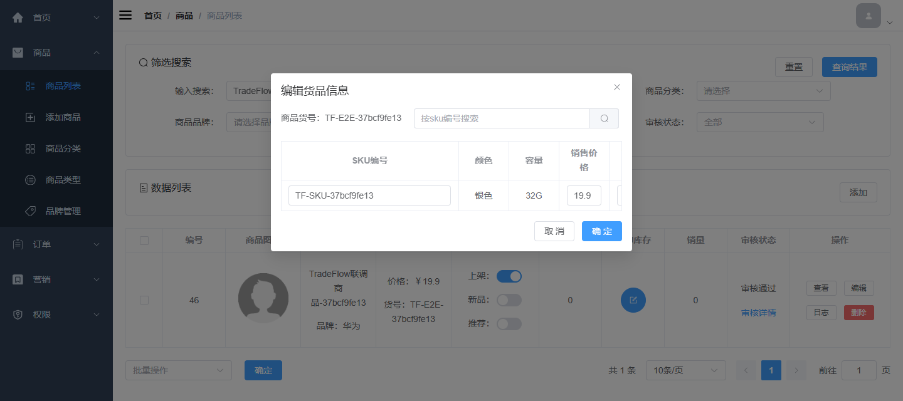
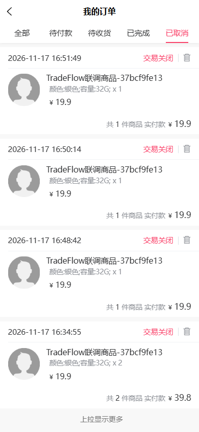
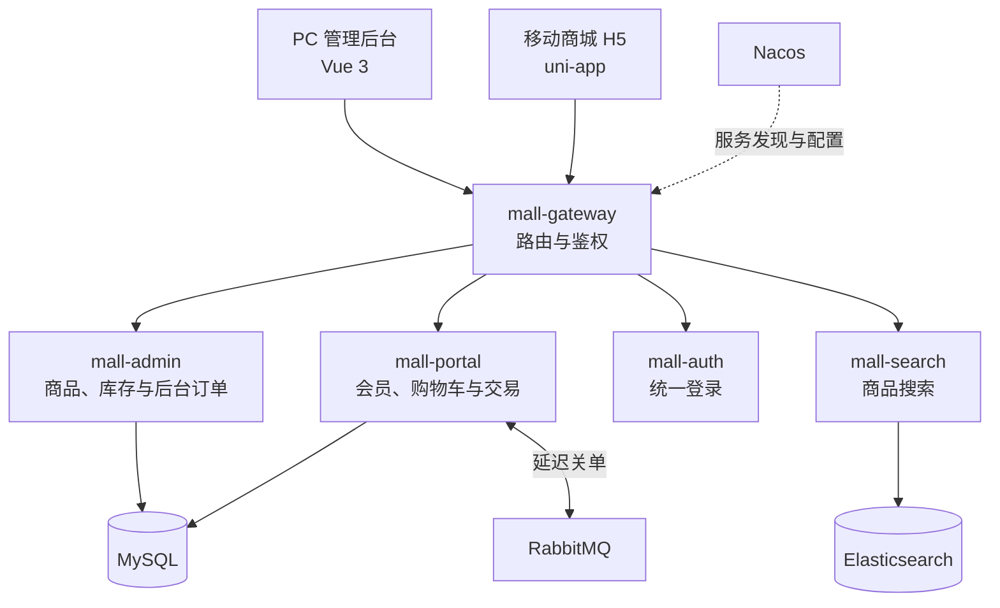

# TradeFlow 商城交易系统

TradeFlow 基于开源 mall-swarm 二次开发，重点加固下单、库存、支付回调和超时关单。仓库包含 Java 微服务后端、Vue 3 管理后台、uni-app 移动商城 H5 及本机联调脚本。

| 交易场景 | 实现 |
| --- | --- |
| 重复下单和库存竞争 | 会员请求键唯一约束、SKU 数量汇总、MySQL 条件更新库存预留 |
| 支付与关单竞争 | 订单行锁与状态条件更新、支付宝回调验签、支付流水去重、异常到账留待核对 |
| 超时消息投递失败 | 事务 Outbox、RabbitMQ 发布确认、退避重试、超时扫描和失败消息重放 |
| 前后端联调 | 通过网关接入两个前端，适配 Bearer Token、下单请求键和业务状态码 |

技术栈包括 Java 17、Spring Boot、Spring Cloud、Nacos、MyBatis、MySQL、Redis、RabbitMQ、Vue 3 和 uni-app。

## 项目演示

两端截图均采集自 TradeFlow 的本机联调环境。按[本机运行](#本机运行)启动后即可查看相应页面。

### PC 管理后台

在「商品 → 商品列表」中检索商品，打开 SKU 库存即可查看售价、库存和预警值。订单的状态可在「订单 → 订单列表」中查看。



### 移动商城 H5

从商品详情选择规格并加入购物车，确认收货地址后提交订单。在「我的订单 → 待付款」中查单或取消，取消后可在「已取消」页查看关闭状态。

<p>
  
  
</p>

## 项目架构

### 系统架构

本机前端经 Vite 的同源 `/api` 代理访问网关。网关按服务路由请求，并通过 Sa-Token 执行登录与权限校验。



Redis 用于缓存与会话，MongoDB 保存商品浏览和收藏等会员数据，MinIO 提供本机对象存储。`mall-monitor` 通过 Spring Boot Admin 汇总服务健康状态。

### 业务架构

会员取消、后台关单和超时关闭都由 `mall-portal` 处理，后台通过 OpenFeign 调用。支付入账和关单共用订单行锁与状态条件更新，库存变化随订单状态一并提交。

```mermaid
flowchart TB
    submit["结算提交 requestKey"] --> dedup{"请求键校验"}
    dedup -->|同键同参数| existing["返回原订单"]
    dedup -->|同键不同参数| reject["拒绝请求"]
    dedup -->|首次结算| order["同一 MySQL 事务<br/>创建待付款订单、预留 SKU<br/>写入 Outbox"]

    order --> payment["支付宝回调验签<br/>或服务端查单"]
    payment -->|满足入账条件| paid["待发货<br/>扣减库存及对应预留"]
    payment -->|可信到账需核对| review["记录 REVIEW<br/>待人工核对"]

    order --> publish["Outbox 发布<br/>等待投递确认"]
    publish -->|RabbitMQ 延迟消息| close["检查关单条件"]
    order -.->|定时扫描补偿| close
    close -->|待付款且可关闭| closed["已关闭<br/>释放对应预留"]
```



### 目录结构

```text
mall-swarm-tradeflow/
├── frontend/
│   ├── mall-admin-web/       # PC 管理后台
│   └── mall-app-web/         # 移动商城 H5
├── mall-gateway/             # API 网关
├── mall-auth/                # 统一认证
├── mall-admin/               # 商品、库存与后台订单管理
├── mall-portal/              # 会员、购物车、订单与支付
├── mall-search/              # 商品搜索
├── mall-monitor/             # 微服务监控
├── mall-demo/                # 服务间调用示例
├── mall-common/              # 通用组件
├── mall-mbg/                 # MyBatis 生成代码
├── config/                   # Nacos 配置模板
├── document/sql/tradeflow/   # 交易可靠性增量 SQL
└── environment/              # 本机依赖、启动与测试脚本
```

## 验证结果

- 49 项新增可靠性回归用例通过，其中 30 项连接真实 MySQL 或 RabbitMQ。8 路请求竞争最后 1 件库存仅 1 路成功，6 路同键并发请求返回同一订单。
- 23 项真实 API 检查通过。Chrome 中验证了管理后台和移动商城，可完成商品录入、购物车、创建未支付订单、查单和取消。取消后确认预留库存已释放。
- 支付验证覆盖回调验签、金额与商户校验及状态流转。真实商户支付、退款和生产部署仍待验收。

详细证据见 [交易可靠性报告](TRADEFLOW_RELIABILITY_REPORT.md)、[E2E 联调报告](E2E_TEST_REPORT.md) 和 [已知问题](BACKEND_ISSUES.md)。

## 本机运行

使用 Windows、Docker Desktop、JDK 17、Maven 3.9.x、Node.js 24 和 Python 3。首次运行按 [环境说明](environment/README.md) 准备隔离的 Compose 环境和演示数据。环境脚本将本机生成的凭据和运行状态写入 Git 忽略的 `environment/.runtime/`。

```powershell
python environment/local.py up

Push-Location frontend/mall-admin-web
npm.cmd ci
Pop-Location

Push-Location frontend/mall-app-web
npm.cmd ci
Pop-Location

.\start-frontend.ps1
.\check-frontend.ps1
```

后端已运行时可直接安装前端依赖并运行前端脚本。编译阶段使用 Maven `test` 生命周期，原 POM 的 `package` 绑定了远程 Docker 构建配置。

| 入口 | 本机地址 |
| --- | --- |
| PC 管理后台 | http://127.0.0.1:15173/ |
| 移动商城 H5 | http://127.0.0.1:15174/ |
| 网关聚合接口文档 | http://127.0.0.1:18201/doc.html |

`stop-frontend.ps1` 用于停止两端前端。接口代理、账户配置和测试入口见 [前端运行说明](FRONTEND_SETUP.md) 和 [前端架构](FRONTEND_ARCHITECTURE.md)。

## 上游与许可证

| 组件 | 上游 | 本次改造的基线提交 |
| --- | --- | --- |
| 微服务后端 | [macrozheng/mall-swarm](https://github.com/macrozheng/mall-swarm) | `04c442fe318356bae4445a109dde7af297ce1e84` |
| 管理后台 | [macrozheng/mall-admin-web](https://github.com/macrozheng/mall-admin-web) | `81fc17e5a19f452bd854b106a9d59fa1ed5c7eac` |
| 移动商城 | [macrozheng/mall-app-web](https://github.com/macrozheng/mall-app-web) | `b1eb3cde1d74fbf62e72195bafd9322c8149f4c8` |

保留各组件的上游说明和许可证。原后端说明见 [README.upstream.md](README.upstream.md)，根许可证见 [LICENSE](LICENSE)，前端随附依赖的许可见对应目录。
